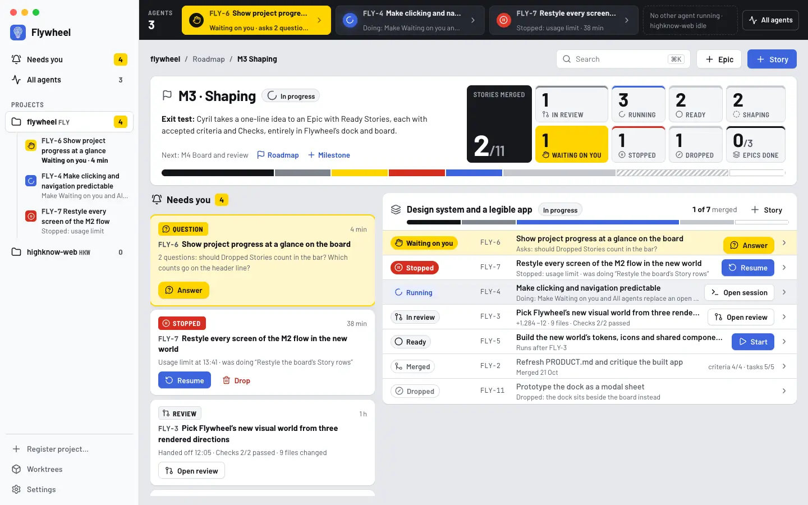
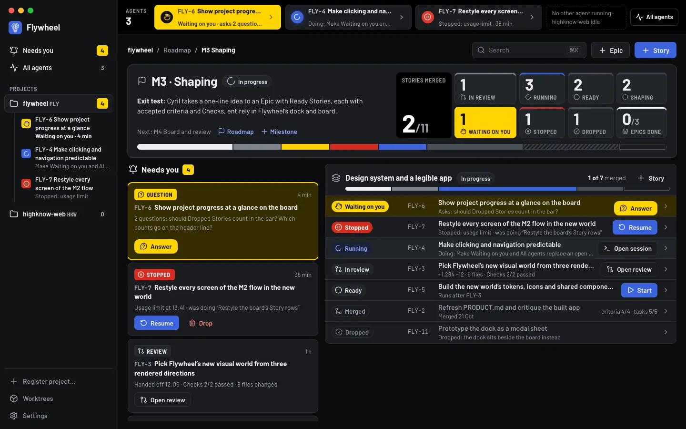
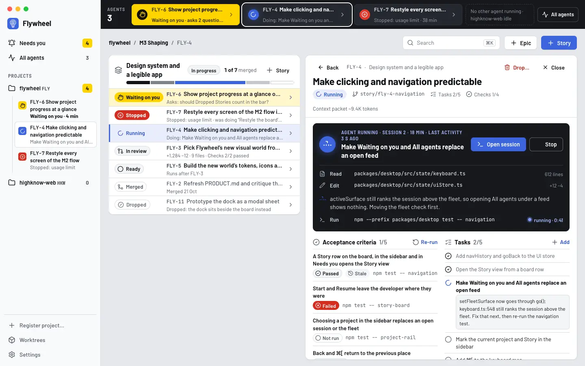
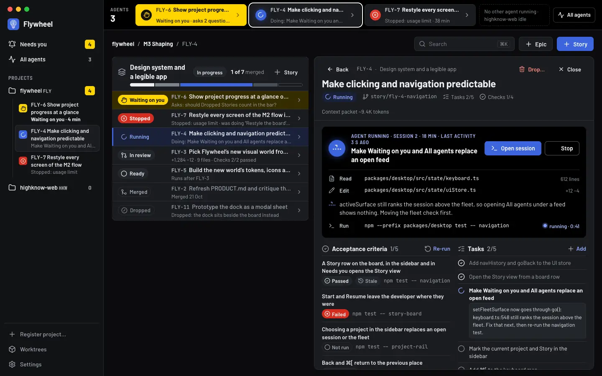
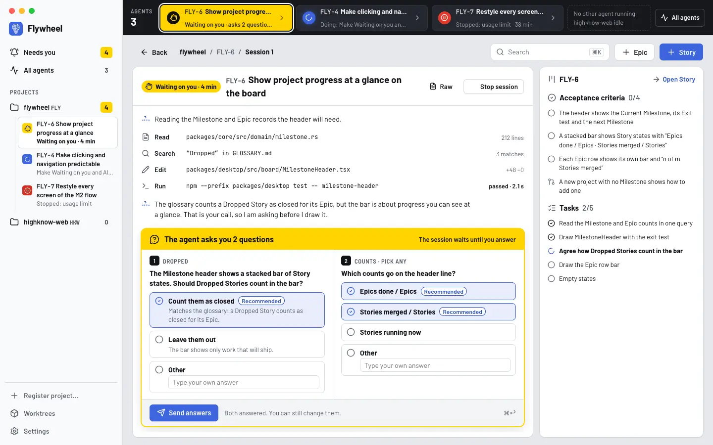
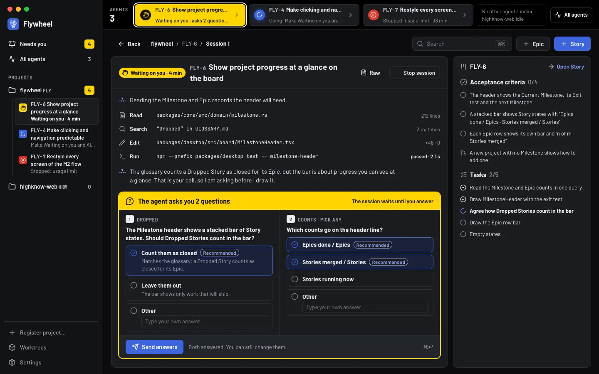

# Flywheel's visual world: Andon

Decided in [Pick Flywheel's new visual world from three rendered directions](https://github.com/HighKnow-ai/flywheel/issues/103) (Epic #97), with `impeccable` (new-work flow, Operate mode). It replaces "Mission Control", whose rules (no filled buttons, no tinted rows, brand spent only on progress) no longer bind. The evidence for the change is [`critique-2026-10.md`](critique-2026-10.md).

Cyril compared three code-rendered directions on 2026-10-21: **A, Plakat** (Swiss poster grid), **B, Andon**, and **C, Departures** (airport departures board). He picked **Andon**, with two changes: fewer colours, and a system built on shadcn/ui and Tailwind so that the build lands as one design. This file is the contract for that world. [ADR 0004](../adr/0004-tailwind-and-shadcn-ui-for-the-desktop-ui.md) records the stack decision. Story #105 builds the tokens and components, and #107 restyles the screens.

The mockup, rendered from code over demonstration data shaped like Flywheel's own M3 backlog, is [`directions/andon.html`](directions/andon.html). Open it in a browser and add `?theme=dark` for the dark scheme.

| | Light | Dark |
|---|---|---|
| Board, with the Milestone header |  |  |
| Story, with its live agent |  |  |
| Waiting on you: the agent's question |  |  |

## Direction contract

- **Thesis.** Kanban came from Toyota's line, and so does the andon: a lamp a station lights when the line needs a person. Every live session is a lamp in one strip across the top of every screen, so "where is the agent" and "what needs me" always have the same answer. The world refuses the category default: a grey list of same-weight rows with one accent colour.
- **Own world.** A neutral grey floor with white cards on it. A graphite strip holds the lamps. Barlow (DIN road-sign lineage) with tabular numerals. One loud colour, safety yellow, means Waiting on you and nothing else. The brand blue means an agent at work or your next action. Red means Stopped or failed. Every other state is neutral and is told apart by its icon and word.
- **Story.** Cyril opens the app and reads, without opening anything, how far the Current Milestone has come, which agents are running, and which one needs him. He clicks the lit lamp or its row and answers.
- **First viewport.** The macOS window. A light sidebar (projects with their Needs-you counts, live sessions under each project). The andon strip across the content top, 72px. The breadcrumb and the add controls (+ Epic, + Story filled). The production-board Milestone header: name, Exit test, a dark count box "Stories merged 2/11", a box per state, and a stacked bar. Below it, two columns: Needs you as cards (400px) and the roster, with each Epic as a card and its Stories as rows.
- **Form.** Lean visual management (andon and production board). It was impeccable's own top-ranked candidate (#1 of seven), offered as the pick card beside the roll's assigned direction (Plakat) and a catalog challenger (Departures). Seed: `seed:3b9829d223c3d146`.
- **Signature interaction.** A lamp lights. When a session becomes Waiting on you, its lamp turns yellow in place and stays lit until the request is answered. Its row and Needs-you card take the yellow tint in the same frame. Nothing moves on screen and nothing opens.
- **Finish.** Unreviewed and undocumented is unfinished. The build (#105, #107) ends with the finish review, the verdict, DESIGN.md, and every shipping raster carrying its provenance. Today's `DESIGN.md` describes Mission Control and is replaced from the built world at that point.

## Colour: one meaning per colour

Cyril asked for fewer colours. Five hues carry meaning. Every other surface is a neutral grey, and states that are not attention, running or failure are neutral: their icon and word do the work.

| Colour | Light | Dark | Its one meaning |
|---|---|---|---|
| Safety yellow (`--attention`) | `#ffd400`, ink `#14120a` | same | **Waiting on you.** The lit lamp, the Needs-you count, the Waiting-on-you pill, the request card's header, the Answer button, and the tint of rows that need you. |
| Brand blue (`--primary`, `--running`) | `#3c64dd` fill, text `#2a50c6` | `#3c64dd` fill, text lifted to `#8ea8ff` | **An agent at work, or your next action.** Running pills and lamps, the doing Task, the live-agent station, filled primary buttons, the focus ring, links. |
| Red (`--destructive`) | `#d42c1f`, text `#b42318` | `#d42c1f`, text `#ff8a7f` | **Stopped or failed.** Stopped pills and lamps, a failed Check, Drop and other destructive actions. |
| Graphite (`--strip`) | `#17191e` | `#000000` | **The live strip and the lead count.** Hardware, not a state. |
| Neutral grey ramp | see tokens | see tokens | Everything else: Shaping, Ready, In review, Merged, Dropped, passed / not run / timed out / stale Checks, open and done Tasks. |

No green anywhere: passed reads from the check icon and its word. The brand blue keeps the hue of the HighKnow mark (`hsl(225, 70%, 55%)`). On dark grounds its text is lifted to `#8ea8ff`, the same hue, as PRODUCT.md's brand rule requires.

## Tokens (shadcn/ui variable names, Tailwind v4)

Each token keeps the variable name shadcn/ui uses, so its generated components theme correctly without edits. Flywheel adds `attention`, `running`, `strip`, `lamp` and `subtle-foreground`. In `globals.css`, `:root` holds light, `.dark` holds dark, and `@theme inline` maps each name to a Tailwind colour (`--color-attention: var(--attention)`, so `bg-attention` works). `.dark` is set from `prefers-color-scheme` and from the existing theme setting.

| Token | Light | Dark | Used for |
|---|---|---|---|
| `--background` | `#e6e8ec` | `#0b0c0e` | the floor the cards sit on |
| `--foreground` | `#111318` | `#eceef1` | body text |
| `--card` / `--popover` | `#ffffff` | `#1a1c20` | cards, panels, popovers, dialogs |
| `--card-foreground` / `--popover-foreground` | `#111318` | `#eceef1` | |
| `--primary` | `#3c64dd` | `#3c64dd` | filled primary button, Running fill, lamp bulb |
| `--primary-foreground` | `#ffffff` | `#ffffff` | text on primary |
| `--running` | `#2a50c6` | `#8ea8ff` | Running text and icons, doing Task, links |
| `--running-muted` | `#e8edfc` | `#19213a` | Running pill ground, selected row |
| `--attention` | `#ffd400` | `#ffd400` | Waiting on you (fills) |
| `--attention-foreground` | `#14120a` | `#14120a` | text on attention |
| `--attention-muted` | `#fff7cc` | `#352d00` | tint of a row or card that needs you |
| `--destructive` | `#d42c1f` | `#d42c1f` | Stopped and failed fills |
| `--destructive-foreground` | `#ffffff` | `#ffffff` | text on destructive |
| `--destructive-text` | `#b42318` | `#ff8a7f` | Drop and other destructive text buttons |
| `--secondary` / `--muted` | `#f4f5f7` | `#23262b` | neutral pills, secondary button ground, inset panels |
| `--secondary-foreground` | `#111318` | `#eceef1` | |
| `--muted-foreground` | `#525866` | `#a0a6b1` | secondary text |
| `--subtle-foreground` | `#676d79` | `#80868f` | meta, chevrons, timestamps |
| `--accent` | `#eef0f3` | `#23262b` | hover |
| `--accent-foreground` | `#111318` | `#eceef1` | |
| `--border` | `#d9dce1` | `#2c2f36` | card edges, row rules, region edges |
| `--input` | `#858b96` | `#6e7480` | control boundaries (inputs, outline buttons, radios) |
| `--ring` | `#3c64dd` | `#8ea8ff` | focus ring, 2px, 2px offset |
| `--sidebar` | `#f8f9fa` | `#121316` | sidebar ground |
| `--sidebar-foreground` | `#111318` | `#eceef1` | |
| `--sidebar-primary` | `#ffffff` | `#1a1c20` | current project or Story: a raised card in the sidebar |
| `--sidebar-primary-foreground` | `#111318` | `#eceef1` | |
| `--sidebar-accent` | `#e9ebef` | `#1e2025` | sidebar hover |
| `--sidebar-border` / `--sidebar-ring` | `#d9dce1` / `#3c64dd` | `#2c2f36` / `#8ea8ff` | |
| `--strip` | `#17191e` | `#000000` | andon strip, lead count box, live-agent station |
| `--strip-foreground` | `#f2f3f5` | `#f2f3f5` | text on the strip |
| `--strip-muted-foreground` | `#a4a9b3` | `#9aa0aa` | secondary text on the strip |
| `--lamp` | `#25282f` | `#1a1c20` | an unlit lamp |
| `--chart-1` … `--chart-4` | `#111318` · `#7d838f` · `#3c64dd` · `#c3c7ce` | `#eceef1` · `#7d838f` · `#3c64dd` · `#4a4f58` | stacked bar: Merged · In review · Running · Ready. Shaping is a hatch of chart-4, Dropped an outline; Waiting on you and Stopped use attention and destructive |
| `--radius` | `0.625rem` | | cards 10px, buttons and inputs 8px, pills fully round |

### Measured contrast per role

Measured with the WCAG 2 formula on the values above. #105 turns this table into the runnable assertion that `theme/__tests__/contrast.test.ts` already is for today's tokens. The test, not this table, owns the numbers.

| Role | Light | Ratio | Dark | Ratio |
|---|---|---|---|---|
| Body text (foreground on card) | `#111318` on `#ffffff` | 18.58:1 | `#eceef1` on `#1a1c20` | 14.68:1 |
| Body text on the floor | `#111318` on `#e6e8ec` | 15.15:1 | `#eceef1` on `#0b0c0e` | 16.83:1 |
| Secondary text (muted-foreground on card) | `#525866` on `#ffffff` | 7.13:1 | `#a0a6b1` on `#1a1c20` | 6.97:1 |
| Secondary text on the floor | `#525866` on `#e6e8ec` | 5.81:1 | `#a0a6b1` on `#0b0c0e` | 8:1 |
| Meta and chevrons (subtle-foreground on card) | `#676d79` on `#ffffff` | 5.2:1 | `#80868f` on `#1a1c20` | 4.65:1 |
| Primary button | `#ffffff` on `#3c64dd` | 5.17:1 | `#ffffff` on `#3c64dd` | 5.17:1 |
| Running pill text | `#2a50c6` on `#e8edfc` | 5.86:1 | `#8ea8ff` on `#19213a` | 6.97:1 |
| Link or Running text on card | `#2a50c6` on `#ffffff` | 6.86:1 | `#8ea8ff` on `#1a1c20` | 7.47:1 |
| Waiting on you | `#14120a` on `#ffd400` | 13.09:1 | `#14120a` on `#ffd400` | 13.09:1 |
| Stopped or failed | `#ffffff` on `#d42c1f` | 5.02:1 | `#ffffff` on `#d42c1f` | 5.02:1 |
| Destructive text on card (Drop) | `#b42318` on `#ffffff` | 6.57:1 | `#ff8a7f` on `#1a1c20` | 7.47:1 |
| Neutral state pill | `#111318` on `#f4f5f7` | 17.03:1 | `#eceef1` on `#23262b` | 13.06:1 |
| Strip text on a lamp | `#f2f3f5` on `#25282f` | 13.29:1 | `#f2f3f5` on `#1a1c20` | 15.37:1 |
| Strip secondary text on a lamp | `#a4a9b3` on `#25282f` | 6.26:1 | `#9aa0aa` on `#1a1c20` | 6.49:1 |
| Lit lamp on the strip | `#ffd400` on `#17191e` | 12.28:1 | `#ffd400` on `#000000` | 14.67:1 |
| Focus ring vs card (non-text, needs 3:1) | `#3c64dd` on `#ffffff` | 5.17:1 | `#8ea8ff` on `#1a1c20` | 7.47:1 |
| Control boundary (input vs card, needs 3:1) | `#858b96` on `#ffffff` | 3.43:1 | `#6e7480` on `#1a1c20` | 3.63:1 |
| Card vs floor (region) | `#ffffff` on `#e6e8ec` | 1.23:1 | `#1a1c20` on `#0b0c0e` | 1.15:1 |
| Strip vs floor (region) | `#17191e` on `#e6e8ec` | 14.33:1 | `#000000` on `#0b0c0e` | 1.07:1 |
| Sidebar vs floor (region) | `#f8f9fa` on `#e6e8ec` | 1.16:1 | `#121316` on `#0b0c0e` | 1.05:1 |
| Border vs card (region edge) | `#d9dce1` on `#ffffff` | 1.37:1 | `#2c2f36` on `#1a1c20` | 1.27:1 |
| Border vs floor (region edge) | `#d9dce1` on `#e6e8ec` | 1.12:1 | `#2c2f36` on `#0b0c0e` | 1.46:1 |

Regions are told apart by three things together: a ground step, the 1px `--border` edge, and the card shadow (`0 1px 2px rgb(15 20 30 / 0.08)`). Mission Control measured 1.03 to 1.06 with no edge at all. In dark mode the ground step is small, so the edge is mandatory: every card, the sidebar and the strip draw their `--border` edge. The stacked bar's neutral segments (Ready `#c3c7ce`, 1.7:1 on white) are never the only carrier of a count: the count box above names every state with its number, icon and word.

## Type

- **Barlow** 400, 500, 600 and 700 for everything people read. **Barlow Semi Condensed** 600, uppercase with 0.04 to 0.08em tracking, only for count labels, the strip's labels and sidebar group names, never as an eyebrow above a heading. **JetBrains Mono** 400 for Story keys, branches, paths and commands. All three are SIL OFL 1.1 and self-hosted through `@fontsource` packages, so a render on one machine matches another (PRODUCT.md house method). Numerals are tabular wherever they count.
- **Scale:** 12 (meta, labels) · 13 (secondary) · 14 (body, rows, buttons) · 15 (row titles) · 17 (section headings) · 24 (Story title) · 26 (Milestone name) · 34 (count boxes) · 52 (the lead count). Weight steps from 400 to 700. The ratio between body and page title is 1.7, against Mission Control's 1.15.

## Icons

**Lucide** (`lucide-react`, ISC licence, already installed at 1.43.0, and shadcn/ui's default set). The Phosphor glyphs in the comparison round are replaced, because one set across shadcn's generated components and Flywheel's own is the cohesion the stack decision is for. Icons use a 2px stroke at 16px, 15px inside pills, and 18px in navigation. Every icon sits next to its word. An icon alone is allowed only with a tooltip and an `aria-label`.

| Meaning | Lucide icon |
|---|---|
| Story states: Shaping, Ready, Running, In review, Merged, Dropped | `circle-dashed`, `circle`, `loader-circle`, `git-pull-request`, `git-merge`, `circle-slash` |
| Attention: Waiting on you, Stopped | `hand`, `circle-pause` |
| Checks: passed, failed, not run, timed out, stale, judged at review | `circle-check`, `circle-x`, `circle`, `hourglass`, `history`, `git-pull-request` |
| Tasks: open, doing, done, dropped | `circle`, `loader-circle`, `circle-check`, `circle-slash` |
| Records: Milestone, Epic, project, worktree, session | `flag`, `layers`, `folder`, `box`, `terminal` |
| Repo knowledge: an ADR, a glossary term (#129) | `scroll-text`, `book-a` |
| Needs-you kinds: question, Gated action, permission request, review, shaping Round | `message-circle-question-mark`, `shield-alert`, `key-round`, `git-pull-request`, `circle-dashed` |
| Feed rows: Read, Edit, Run, Search, board tool, agent turn | `file-text`, `pencil`, `terminal`, `search`, `kanban`, `bot` |
| Actions: Start, Stop, Resume, Drop, add, Back, opens, Open session | `play`, `square`, `rotate-ccw`, `trash-2`, `plus`, `arrow-left`, `chevron-right`, `square-arrow-out-up-right` |
| Places: Needs you, All agents, Settings | `bell-ring`, `activity`, `settings` |

## Components

### shadcn/ui components the app uses

Generated into `packages/desktop/src/components/ui/` by the shadcn CLI. The code is ours to edit, built on Radix primitives:

| Component | Where |
|---|---|
| `Button` | every action. Variants: `default` (filled primary), `attention` (added: Answer, Allow on a Waiting-on-you item), `secondary`, `outline`, `ghost`, `destructive` (text-styled Drop), `link` |
| `Badge` | state pills, Check chips, Needs-you kinds, counts. Variants follow the tones below |
| `Card` | Milestone header, Needs-you item, Epic group, Story panel, request cards |
| `Sidebar` | the project sidebar, its groups, and session sub-items |
| `Breadcrumb` | "flywheel / M3 Shaping / FLY-4" in the top bar |
| `Command` (cmdk) inside `Dialog` | the ⌘K palette |
| `Dialog` / `AlertDialog` | AlertDialog confirms Drop and Stop; Dialog holds the resume note and Write a Story |
| `Popover` | pickers (Epic, Milestone), the Always-allow pattern editor |
| `Tooltip` | every icon-only control, truncated titles, lamp details |
| `DropdownMenu` | row overflow (Move to Epic, Copy branch), project menu |
| `Sheet` | Needs you when the window is under 1280px (the shaping dock stacks instead: DESIGN.md, Round Dock) |
| `Collapsible` | a Task's note, a failed tool call, older sessions |
| `Checkbox` / `RadioGroup` / `Label` | the question card's choices, criteria acceptance at review |
| `Input` / `Textarea` | Other answers, Check commands, notes |
| `ScrollArea` | roster, feed, Story panel |
| `Separator` / `Skeleton` / `Kbd` | rules, loading rows, shortcut hints |

### Flywheel components, built from them

`AndonStrip` and `Lamp` · `MilestoneHeader` (`CountBox`, `StackedBar`) · `NeedsYouCard` · `EpicGroup` · `StoryRow` · `StatePill` · `AgentStation` (the live-agent block on a Story) · `CriterionRow` and `CheckChip` · `TaskRow` · `FeedRow` · `QuestionCard` · `GatedActionCard` · `PermissionRequestCard`.

### Rules

1. **Tones.** Every state maps to one tone: `attention` (Waiting on you), `running` (Running, doing Task), `destructive` (Stopped, failed Check), or `neutral` (everything else). `StatePill` takes a state and renders its icon, its word and its tone. No component picks a state colour itself.
2. **One filled primary action per region.** It is brand blue. The only other filled action colour is attention, and only on an item that is Waiting on you (Answer, Allow once on a permission request). On a Gated action, Deny leads as the filled neutral (`foreground` fill) and Allow once is outline, as in the M2 card the critique kept. Drop is a destructive text button, set apart from the primary, and always confirms in an AlertDialog.
3. **What is clickable looks clickable.** Anything that navigates (a Story row, a lamp, a Needs-you card, a sidebar session) is a bounded object with a trailing `chevron-right`, an `accent` hover and the focus ring. Inert text never carries a chevron. Buttons carry an icon and a word. Links are `running` text.
4. **Rows that need you are tinted** `attention-muted`. The selected row is `running-muted`.
5. **Depth:** cards use `--border` plus the card shadow. Popovers and dialogs use `0 8px 24px rgb(15 20 30 / 0.16)`. No glow anywhere, except the lit bulb of a lamp, whose glow is its meaning.
6. **Spacing:** 4px base; 8 inside a group, 12 to 16 between groups, 20 between regions. Rows are 44px, sidebar rows 36px.
7. **Motion:** one curve, `cubic-bezier(0.16, 1, 0.3, 1)`, 160ms for state changes and 240ms for a lamp lighting. A live dot may pulse. Under `prefers-reduced-motion` nothing animates.
8. **Browser surfaces:** selection uses `--primary` with white text, scrollbars are thin `--border` thumbs, and the caret is `--running`.

## Click and navigation model

This keeps the model #104 shipped (`state/uiStore.ts`: `openStory`, `goBack`, `navHistory`; spec §7 "Click model") and gives each rule its visual form.

| You click | You land on | Never |
|---|---|---|
| A project in the sidebar | that project's board. It replaces whatever was showing: a session, the fleet, a Story | leaves a session or the fleet on top |
| A Story row: the roster, a sidebar session, a Needs-you card's title, a **lamp** | the Story view | opens the session |
| **Open session** / **Open feed** (labelled, `terminal` icon) on a row, the station, or the Story's session list | that session's feed | appears without a label |
| **Answer** / **Allow once** on a Waiting-on-you item | the session feed, scrolled to the open request | |
| **Start**, **Resume** | stays where you are. The row turns Running, and a lamp appears and lights blue | pushes into the feed |
| **Back**, ⌘[, or the Story panel's × | the previous place | goes "to the board" when you came from elsewhere |
| A row in All agents (a list of sessions) | that session. Its Story key opens the Story | |
| An OS notification for a request | the session feed at that request | |

- **Where you are** is always shown: the breadcrumb names the project, the Milestone or the Story, and the session. The sidebar marks the current project and Story as a raised card, and the selected lamp carries a white outline.
- **The Story view** has the roster beside it at content widths of 1280px and up (roster 470px, Story panel the rest). From 900px (the window's `minWidth`) to 1279px it takes the whole content area. The Story stays one place in `navHistory` either way.
- **The andon strip** shows every live session in every project, oldest Waiting-on-you first, then Running, then Stopped. Past the strip's width, it shows a "+n more" lamp that opens All agents. With nothing running, it shows one quiet line ("No agent running") and keeps its height, so the layout never jumps.

## Not chosen

- **A, Plakat** (Swiss grid; one cell per Story on every bar). It lent the fixed-scale discipline the stacked bars keep: every bar on the board uses the same scale.
- **C, Departures** (Needs you as a ranked departures board; dark means live). It lent "a row that changed stays lit until noticed", which is now the lamp's behaviour.
