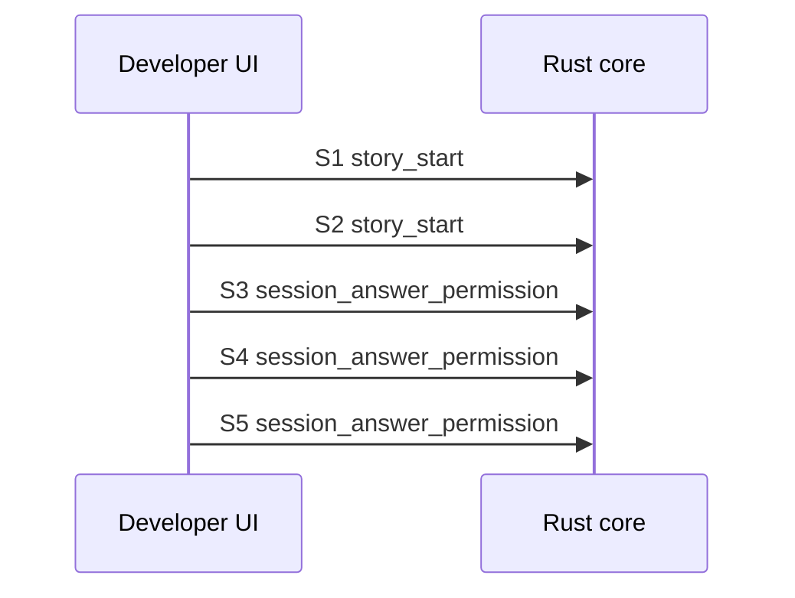

# Answer the blocked queue

## Purpose

An agent that asks for a permission waits. The blocked queue lists each waiting agent. The developer answers each request, and each answer removes one entry.

## Sequence

The agent is a script (`packages/desktop/e2e/agents/blocking-agent.ts`). It calls the permission tool of its own MCP server and waits for the answer. The permission request is not a board call, so the agent has no step in the diagram. The test reads the queue with a read-only command, which is not a step.

1. S1-S2: The developer starts two Stories. Both agents ask for a permission. The queue has two entries, one for each Story.
2. S3: The developer allows the first request. The queue has one entry, and it is the other request.
3. S4: The developer answers the first request again. The core refuses it, and the queue does not change. This step is in the trace because the command is not a read.
4. S5: The developer denies the second request. The queue is empty.

## Entry points

| Step | Path | Symbol |
|---|---|---|
| S1-S2 | `packages/desktop/src-tauri/src/commands/session.rs` | `story_start` |
| S3-S5 | `packages/desktop/src-tauri/src/commands/session.rs` | `session_answer_permission` |

## Tests

| What it proves | Test path | Covers steps |
|---|---|---|
| The queue shrinks by one for each answer, across two Stories, with the real sidecar relay (D-REV-50). | `packages/desktop/e2e/flows/blocked-queue.spec.ts` | S1-S5 |
| The same queue through the core functions with a database fixture (UAT 12). | `scripts/uat/uat-12-fleet-live-reads.mjs` | none |

## Design

See `ARCHITECTURE.md` section 5 (the IPC seam) and `docs/mvp-spec.md`.

## Last verified

`9a31d3e8b`
