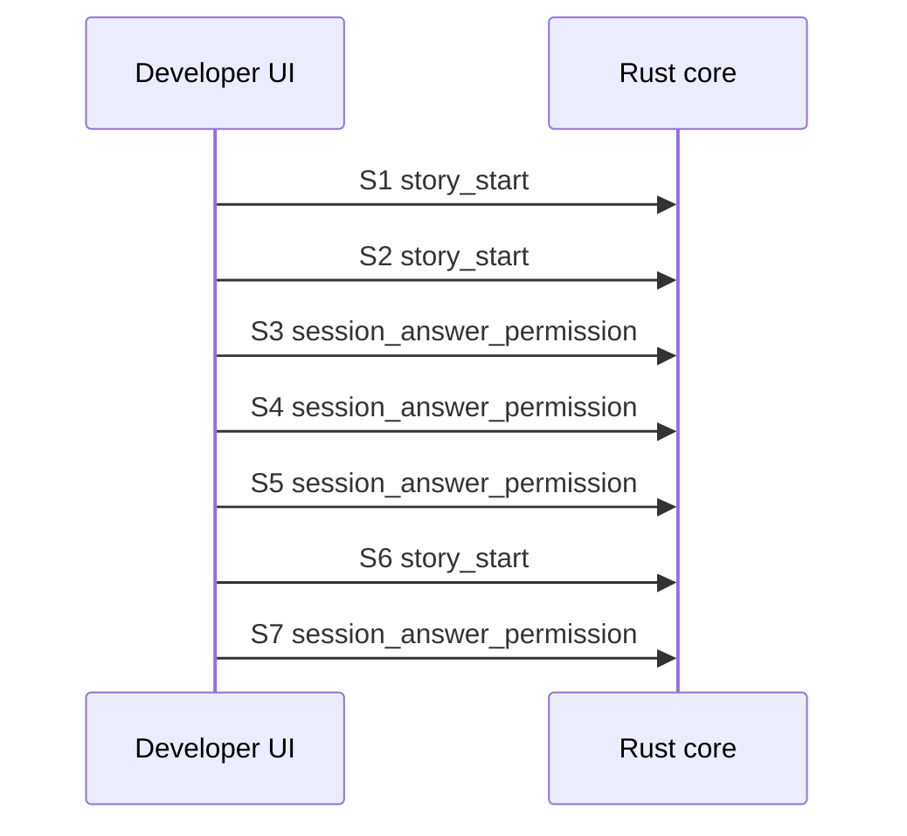

# Answer the blocked queue

## Purpose

An agent that asks for a permission waits. The blocked queue lists each waiting agent. The developer answers each request, and each answer removes one entry. The developer can also answer with Always allow, which saves a rule for the project.

## Sequence

The agent is a script (`packages/desktop/e2e/agents/blocking-agent.ts`). It calls the permission tool of its own MCP server and waits for the answer. The permission request is not a board call, so the agent has no step in the diagram. The test works in the real UI, and it reads the queue from the core with a read-only command, which is not a step. Each step below is a control on the screen, except S4.

1. S1-S2: The developer starts two Stories with the Start button of each Story on the board. Both agents ask for a permission. The rail shows 2 waiting. The Waiting on you queue has two entries, one for each Story, in the order of the core.
2. S3: The first entry owns the keyboard. The developer presses the key A, and the request is allowed. The queue has one entry, and it is the other request. That entry owns the keyboard now.
3. S4: The developer answers the first request again. The screen has no control for this, so the test sends the command. The core refuses it, and the queue does not change, on the screen and in the core. This step is in the trace because the command is not a read.
4. S5: The developer selects Deny on the second request. The queue is empty, and the screen says that nothing is waiting.
5. S6: The developer goes back to the board and starts a third Story. Its agent asks for a permission too, and the queue has one entry.
6. S7: The developer selects Always allow on that entry. The pattern field holds the suggested rule of the request, the exact command of the agent. The developer selects Always allow again, in the pattern form. The core saves the rule for the project and answers the request. The queue is empty. The rules of the project have one rule, for the tool Bash and the command of the agent.

## Entry points

| Step | Path | Symbol |
|---|---|---|
| S1-S2,S6 | `packages/desktop/src/board/StoryControls.tsx` | `StartControl` |
| S1-S2,S6 | `packages/desktop/src-tauri/src/commands/session.rs` | `story_start` |
| S3-S5,S7 | `packages/desktop/src/fleet/BlockedQueue.tsx` | `BlockedQueue` |
| S3-S5,S7 | `packages/desktop/src-tauri/src/commands/session.rs` | `session_answer_permission` |
| S7 | `packages/desktop/src/session/PermissionRequestCard.tsx` | `PermissionRequestCard` |

## Tests

| What it proves | Test path | Covers steps |
|---|---|---|
| The queue shrinks by one for each answer, across two Stories, with the real sidecar relay (D-REV-50). The developer starts and answers in the real UI, with the keyboard and the mouse. | `packages/desktop/e2e/flows/blocked-queue.spec.ts` | S1-S7 |
| The same queue through the core functions with a database fixture (UAT 12). | `scripts/uat/uat-12-fleet-live-reads.mjs` | none |

## Design

See `ARCHITECTURE.md` section 5 (the IPC seam) and `docs/mvp-spec.md`.

## Last verified

`697b72cb2`
