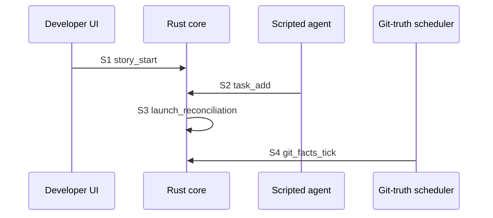

# Start the app after it died with a session running

## Purpose

The app can die while an agent session is `running`: a crash, a power cut or a force quit. The next start must not show that session as running. This flow proves that the start path reconciles it, and that the scheduler of git facts starts on the same path.

## Sequence

The agent is a script (`packages/desktop/e2e/agents/cold-start-agent.ts`). It stays alive until the test kills it.

1. S1: The developer starts a Ready Story. The core makes a worktree and a session, and the session is `running`.
2. S2: The agent writes a Task.
3. The test kills the core with SIGKILL, so no exit step runs, and kills the agent. The database still says the session is `running`.
4. S3: The test starts a new core on the same data. The core runs the same start path as the app: it reads the login `PATH`, opens the database, reconciles projects, worktrees and sessions, starts the sidecar and starts the scheduler. The session is now `abandoned`. It is not a live orphan, because its process is dead.
5. S4: The developer has the Story open. The scheduler ticks for it and reports changed git facts with a `board:changed` event.

S3 and S4 are not commands. The headless core writes them to the trace: S3 when the start path ends, and S4 for the first tick after the test asks for it. The login shell is a stub in the test, so the developer's own shell does not change the run.

## Entry points

| Step | Path | Symbol |
|---|---|---|
| S1 | `packages/desktop/src-tauri/src/commands/session.rs` | `story_start` |
| S2 | `packages/desktop/src-tauri/src/commands/task.rs` | `handle_inbound_board_tool_request` |
| S3 | `packages/desktop/src-tauri/src/startup.rs` | `boot` |
| S4 | `packages/desktop/src-tauri/src/scheduler.rs` | `start_git_truth_scheduler` |

## Tests

| What it proves | Test path | Covers steps |
|---|---|---|
| A session that was running when the app died is `abandoned` after the next start, and the scheduler ticks. | `packages/desktop/e2e/flows/cold-start.spec.ts` | S1-S4 |

## Design

See `ARCHITECTURE.md` and decisions D-16, D-46 and D-113. `main.rs` and `bin/flywheel-headless.rs` both call `startup::adopt_login_path` and `startup::boot`, so the start path has one copy.

## Last verified

`de8c5ada1`
