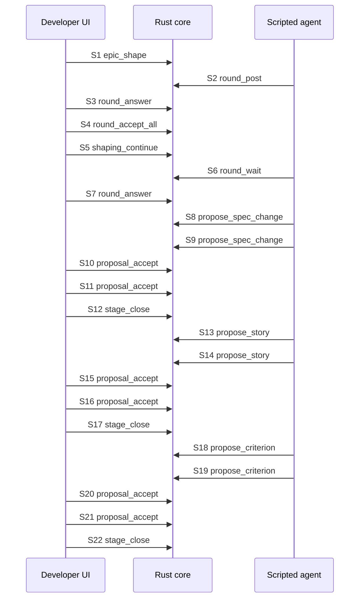

# Shape an Epic to Ready Stories

## Purpose

A developer shapes a one-line Epic with an agent. The agent asks questions, the developer answers them, and the Epic ends with Ready Stories that have criteria and Checks.

## Sequence

The agent is a script (`packages/desktop/e2e/agents/shaping-agent.ts`). The test kills its first session between S4 and S5.

1. S1-S2: The developer shapes the Epic. The agent posts Round 1 with three questions. One question asks for an ADR.
2. S3-S4: The developer answers one question in their own words and accepts the recommended answers for the others. The ADR question stays open.
3. The agent process is killed. The answers stay on the board.
4. S5-S7: The developer continues shaping. A new session takes the open Round. The developer answers the ADR question Yes, and the agent gets all three answers.
5. S8-S12: The agent proposes the Problem and the Exit test. The developer accepts both and closes the first Stage.
6. S13-S17: The agent proposes two Stories. The developer accepts both and closes the second Stage.
7. S18-S22: The agent proposes one criterion with a Check for each Story. The developer accepts both and closes the last Stage. The Epic and its Stories are Ready.

## Entry points

| Step | Path | Symbol |
|---|---|---|
| S1 | `packages/desktop/src-tauri/src/commands/shaping.rs` | `epic_shape` |
| S2, S6, S8-S9, S13-S14, S18-S19 | `packages/desktop/src-tauri/src/commands/shaping.rs` | `handle_shaping_tool_request` |
| S3, S7 | `packages/desktop/src-tauri/src/commands/shaping.rs` | `round_answer` |
| S4 | `packages/desktop/src-tauri/src/commands/shaping.rs` | `round_accept_all` |
| S5 | `packages/desktop/src-tauri/src/commands/shaping.rs` | `shaping_continue` |
| S10-S11, S15-S16, S20-S21 | `packages/desktop/src-tauri/src/commands/proposal.rs` | `proposal_accept` |
| S12, S17, S22 | `packages/desktop/src-tauri/src/commands/shaping.rs` | `stage_close` |

## Tests

| What it proves | Test path | Covers steps |
|---|---|---|
| The real UI shapes an Epic to Ready Stories against the real core and sidecar. | `packages/desktop/e2e/flows/epic-shaping.spec.ts` | S1-S22 |
| The same walk through the core and the sidecar, without the UI (UAT 16). | `scripts/uat/uat-16-epic-shaping.mjs` | S1-S22 |

## Design

See `ARCHITECTURE.md` section 5 (the IPC seam) and `docs/mvp-spec.md`.

## Last verified

`105d35c19`
