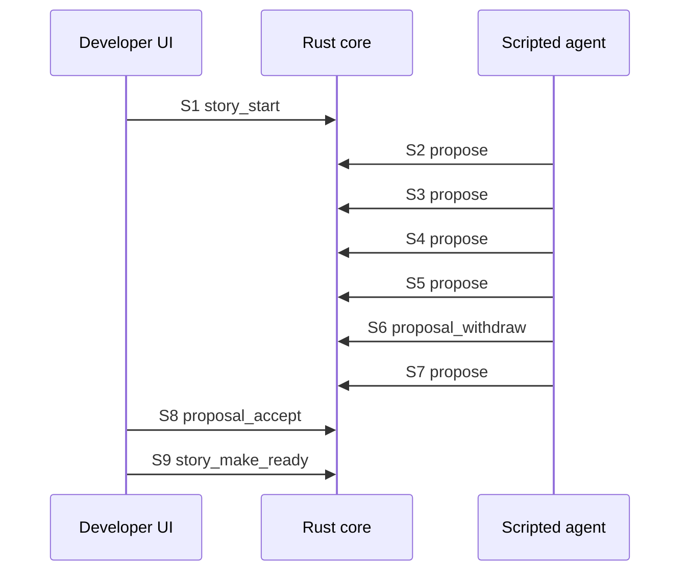

# A running Story files Proposals

## Purpose

An agent works a Story and finds new work. It files Proposals on the board. The core allows three open Proposals for one Story. The developer accepts a New Story and makes it Ready.

## Sequence

The agent is a script (`packages/desktop/e2e/agents/proposals-agent.ts`). The core answers each call at once. No call is held.

1. S1: The developer starts a Ready Story. The core makes a worktree and starts the agent.
2. S2-S4: The agent files a New Story, an Amend Epic spec and a New Epic. The core files all three.
3. S5: The agent files a fourth Proposal. The core refuses it, because three are open. The refusal names `proposal_withdraw`.
4. S6-S7: The agent withdraws the New Epic and files the fourth Proposal again. The core files it.
5. S8: The developer accepts the first New Story. The Story is in Shaping and keeps its two criteria.
6. S9: The developer makes the Story Ready. The Epic is already Ready, so no Stage close can do it.

## Entry points

| Step | Path | Symbol |
|---|---|---|
| S1 | `packages/desktop/src-tauri/src/commands/session.rs` | `story_start` |
| S2-S7 | `packages/desktop/src-tauri/src/commands/task.rs` | `handle_inbound_board_tool_request` |
| S8 | `packages/desktop/src-tauri/src/commands/proposal.rs` | `proposal_accept` |
| S9 | `packages/desktop/src-tauri/src/commands/story.rs` | `story_make_ready` |

## Tests

| What it proves | Test path | Covers steps |
|---|---|---|
| A running Story files three Proposals, is refused a fourth, withdraws one and files again. The developer accepts one and makes it Ready. The core and the sidecar are real. | `packages/desktop/e2e/flows/execution-proposals.spec.ts` | S1-S9 |
| The same walk through the core and the sidecar with a Node driver (UAT 18). | `scripts/uat/uat-18-execution-proposals.mjs` | S1-S9 |

## Design

See `ARCHITECTURE.md` section 5 (the IPC seam) and `docs/mvp-spec.md`.

## Last verified

`9a31d3e8b`
