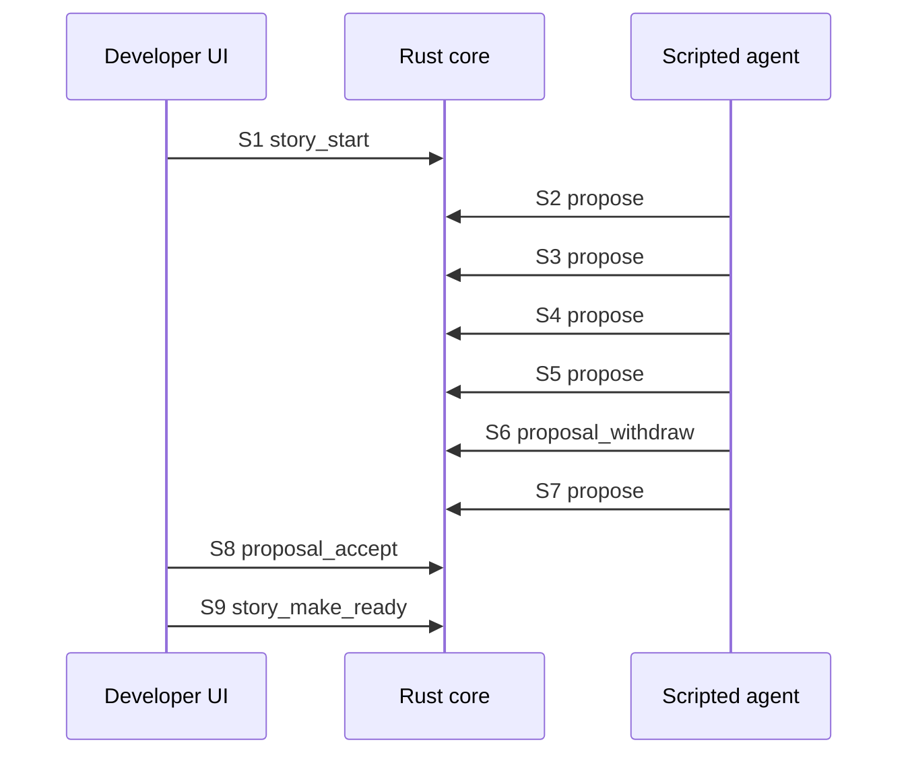

# A running Story files Proposals

## Purpose

An agent works a Story and finds new work. It files Proposals on the board. The core allows three open Proposals for one Story. The developer accepts a New Story and makes it Ready.

## Sequence

The agent is a script (`packages/desktop/e2e/agents/proposals-agent.ts`). The core answers each call at once. No call is held. The test works in the real UI. Each step of the developer is a control on the screen. The test reads the board from the core with read-only commands, which are not steps.

1. S1: The developer selects Start on a Ready Story on the board. The core makes a worktree and starts the agent.
2. S2-S4: The agent files a New Story, an Amend Epic spec and a New Epic. The core files all three.
3. S5: The agent files a fourth Proposal. The core refuses it, because three are open. The refusal names `proposal_withdraw`. The developer can read it in the feed of the session: the Story view lists the session, and Open feed shows the answers of the core. The fourth answer is the error.
4. S6-S7: The agent withdraws the New Epic and files the fourth Proposal again. The core files it. The screen shows three open Proposals. The Amend Epic spec is a card in the Needs you list. The triage drawer holds the two New Stories. The New Epic is not on the screen.
5. S8: The developer selects Triage on the Proposals row of the Needs you list. In the triage drawer, the developer selects Accept on the first New Story. The Story is on the board in Shaping and keeps its two criteria. The drawer keeps the other New Story.
6. S9: The developer selects Make Ready on the Story, in the list of Stories of its Epic. The Epic is already Ready, so no Stage close can do it. The Story is Ready and shows Start.

## Entry points

| Step | Path | Symbol |
|---|---|---|
| S1 | `packages/desktop/src/board/StoryControls.tsx` | `StartControl` |
| S1 | `packages/desktop/src-tauri/src/commands/session.rs` | `story_start` |
| S2-S7 | `packages/desktop/src-tauri/src/commands/task.rs` | `handle_inbound_board_tool_request` |
| S5 | `packages/desktop/src/session/SessionSurface.tsx` | `SessionSurface` |
| S8 | `packages/desktop/src/proposals/ProposalDrawer.tsx` | `ProposalDrawer` |
| S8 | `packages/desktop/src-tauri/src/commands/proposal.rs` | `proposal_accept` |
| S9 | `packages/desktop/src/board/StoryControls.tsx` | `MakeReadyControl` |
| S9 | `packages/desktop/src-tauri/src/commands/story.rs` | `story_make_ready` |

## Tests

| What it proves | Test path | Covers steps |
|---|---|---|
| A running Story files three Proposals, is refused a fourth, withdraws one and files again. The developer accepts one and makes it Ready. The developer starts, accepts and makes Ready in the real UI, with the mouse. The core and the sidecar are real. | `packages/desktop/e2e/flows/execution-proposals.spec.ts` | S1-S9 |
| The same walk through the core and the sidecar with a Node driver (UAT 18). | `scripts/uat/uat-18-execution-proposals.mjs` | S1-S9 |

## Design

See `ARCHITECTURE.md` section 5 (the IPC seam) and `docs/mvp-spec.md`.

## Last verified

`cbdac17ce`
