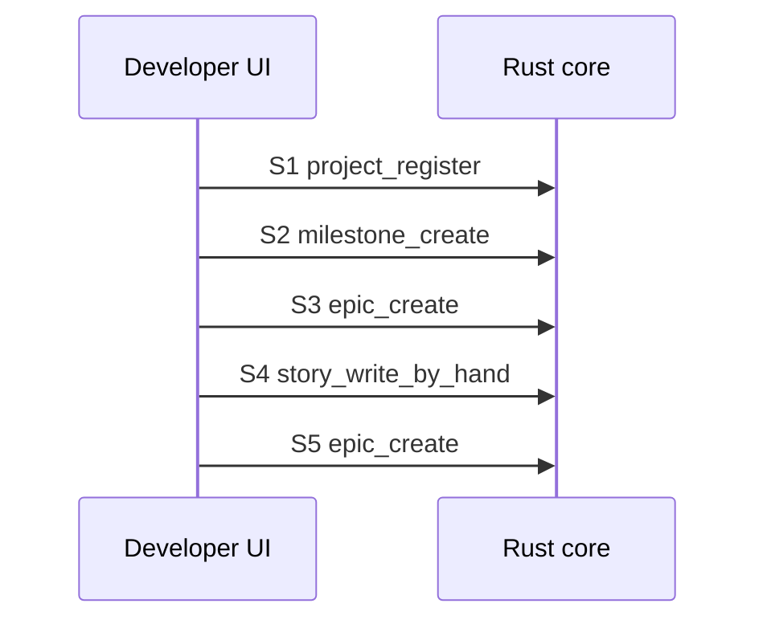

# Register a project and write the first Story

## Purpose

A new developer starts the app with no project. The developer registers a repository, then writes a Milestone, an Epic and a Story by hand. This flow proves that the core does each of these writes from an empty database, and that the board shows the result.

## Sequence

The test works in the real UI, and the agent does nothing. The database is empty at the start, so the app shows first run.

1. S1: The developer registers the repository as the project Threadfin with the key FLY. The native folder picker is not in the test harness (issue #1786), so the test sends the command that the picker's confirm step sends. The renderer reads the project list again, and first run is gone.
2. S2-S4: The developer selects Write a Story and picks New Milestone. The developer types a Milestone title and an exit test, an Epic title, a Story title and two criteria. The first criterion has a Check command. The developer selects Write Story. One submit writes the Milestone, the Epic and the Story, in that order. The Epic gets the key FLY-1 and the Story gets the key FLY-2. The Story is Ready, and the board shows it.
3. S5: The developer selects Add an Epic in the header of the Milestone. The Milestone is already chosen. The developer types an Epic title, and the Epic gets the key FLY-3.

The test then reads the Milestone, the Epics, the Story and its criteria from the core. The first criterion has its Check, and the Check has not run. The second criterion has no Check, so the developer judges it at review.

## Entry points

| Step | Path | Symbol |
|---|---|---|
| S1 | `packages/desktop/src-tauri/src/commands/project.rs` | `project_register` |
| S2-S4 | `packages/desktop/src/board/WriteStoryDialog.tsx` | `StoryForm` |
| S2 | `packages/desktop/src-tauri/src/commands/roadmap.rs` | `milestone_create` |
| S3,S5 | `packages/desktop/src-tauri/src/commands/epic.rs` | `epic_create` |
| S4 | `packages/desktop/src-tauri/src/commands/story.rs` | `story_write_by_hand` |
| S5 | `packages/desktop/src/board/AddRecordControls.tsx` | `AddEpicToMilestone` |

## Tests

| What it proves | Test path | Covers steps |
|---|---|---|
| The core registers a project, and writes a Milestone, two Epics and a Story with criteria and a Check, from an empty database. The developer writes them in the real UI. | `packages/desktop/e2e/flows/first-project-and-story.spec.ts` | S1-S5 |

## Design

See `ARCHITECTURE.md` section 5 (the IPC seam) and `docs/mvp-spec.md`.

## Last verified

`000f5b540`
