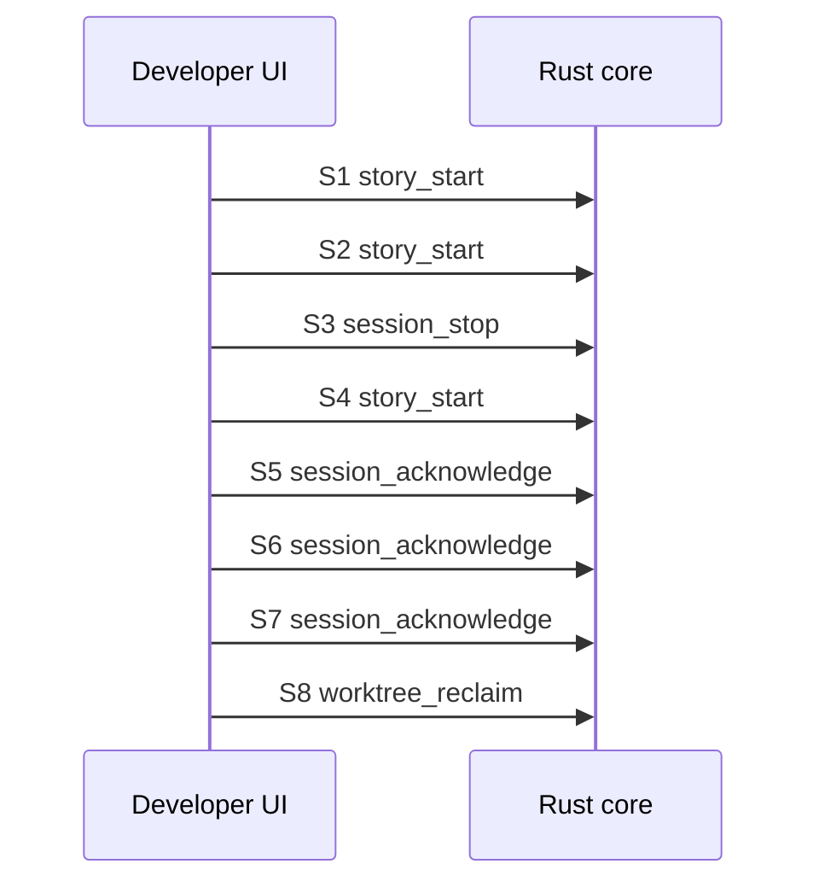

# Read the fleet while runs go on and end

## Purpose

The fleet lists every run across the projects. A live run shows the end of its log. A finished run stays on the fleet until the developer acknowledges it. A reclaim does not remove a worktree that is in use.

## Sequence

The agent is a script (`packages/desktop/e2e/agents/fleet-agent.ts`). It makes 20 commits and stays alive. A commit is not a board call, so the agent has no step in the diagram. The test reads the fleet with read-only commands, which are not steps.

1. S1: The developer starts the first Story. The fleet row of the run shows 16 lines of its log, the newest line last. The log has more than 16 lines, so the row shows the end only.
2. The test ends the agent with a kill signal, as a crash does. The run is no longer live. Its row stays on the fleet and has no log lines.
3. S2-S3: The developer starts the second Story and stops its run. This row stays on the fleet too.
4. S4: The developer starts the third Story. The fleet has three rows.
5. S5: The developer acknowledges the live run. The core does nothing, and the row stays.
6. S6-S7: The developer acknowledges the stopped run and then the killed run. Each call removes one row.
7. S8: The developer reclaims the three worktrees. No Story is closed, so the core refuses all three and removes none. The inventory names the worktree of the live run `in_use` with the reason `sessionning`.

## Not covered here

Removing a reclaimable worktree is not a flow. A worktree is reclaimable when its Story is Merged or Dropped and the worktree is still on disk. No command makes that state: a merge and a drop both remove the worktree. The offline UAT `scripts/uat/uat-12-fleet-live-reads.mjs` keeps this check (D-REV-55) with a database fixture. It also keeps the timing bound for a fleet read during a large reclaim.

## Entry points

| Step | Path | Symbol |
|---|---|---|
| S1, S2, S4 | `packages/desktop/src-tauri/src/commands/session.rs` | `story_start` |
| S3 | `packages/desktop/src-tauri/src/commands/session.rs` | `session_stop` |
| S5-S7 | `packages/desktop/src-tauri/src/commands/session.rs` | `session_acknowledge` |
| S8 | `packages/desktop/src-tauri/src/commands/fleet.rs` | `worktree_reclaim` |

## Tests

| What it proves | Test path | Covers steps |
|---|---|---|
| The log tail (D-REV-48), the acknowledge (D-REV-49) and the refusal to reclaim a worktree in use, against the real core and sidecar. | `packages/desktop/e2e/flows/fleet-live-reads.spec.ts` | S1-S8 |
| The same reads, and the reclaim of closed Stories (D-REV-55), through the core functions with a database fixture (UAT 12). | `scripts/uat/uat-12-fleet-live-reads.mjs` | none |

## Design

See `ARCHITECTURE.md` section 5 (the IPC seam) and `docs/mvp-spec.md`.

## Last verified

`9a31d3e8b`
