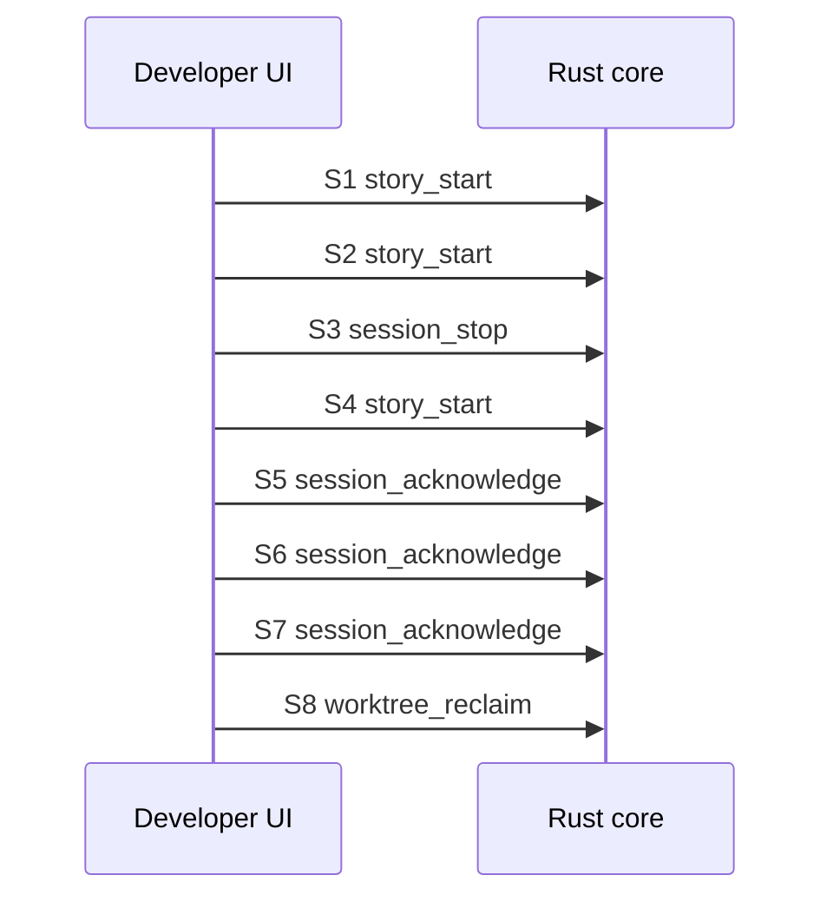

# Read the fleet while runs go on and end

## Purpose

The fleet lists every run across the projects. A live run shows the end of its log. A finished run stays on the fleet until the developer acknowledges it. A reclaim does not remove a worktree that is in use.

## Sequence

The agent is a script (`packages/desktop/e2e/agents/fleet-agent.ts`). It makes 20 commits and stays alive. A commit is not a board call, so the agent has no step in the diagram. The test works in the real UI. It reads the fleet from the core with read-only commands, which are not steps. Each step is a control on the screen, except S5 and S8. The screen has no control for these two steps, so the test sends them as commands.

1. S1: The developer selects Start on the first Story on the board, and then opens All agents. The fleet row of the run shows the newest line of its log, which is the last commit. The row in the core holds 16 lines of the log, the newest line last. The log has more than 16 lines, so the row shows the end only. The screen shows one line, so the test counts the 16 lines in the core.
2. The test ends the agent with a kill signal, as a crash does. This is not a control of the developer. The run is no longer live. Its row stays on the fleet. The row says Stopped, shows a Dismiss button and has no log line.
3. S2-S3: The developer selects Start on the second Story. The developer opens that Story from its row on All agents, selects Stop and confirms with Stop the session. This row stays on the fleet too.
4. S4: The developer selects Start on the third Story. The fleet has three rows. The header counts 1 agent and 2 ended runs.
5. S5: The test acknowledges the live run with the command. The screen has no control for this: a live row has no Dismiss button. The core does nothing, and the row stays.
6. S6-S7: The developer selects Dismiss on the stopped run and then on the killed run. Each call removes one row.
7. S8: The test reclaims the three worktrees with the command. The screen has no control for this: the Worktrees screen has no checkbox on a worktree that is not reclaimable. No Story is closed, so the core refuses all three and removes none. The Worktrees screen shows the worktree of the live run as In use with the reason "agent running". It shows the other two as Keep with the reason "Story still open". The screen lists all three worktrees before and after the command. The inventory in the core names the worktree of the live run `in_use` with the reason `sessionning`.

## Not covered here

Removing a reclaimable worktree is not a flow. A worktree is reclaimable when its Story is Merged or Dropped and the worktree is still on disk. No command makes that state: a merge and a drop both remove the worktree. The offline UAT `scripts/uat/uat-12-fleet-live-reads.mjs` keeps this check (D-REV-55) with a database fixture. It also keeps the timing bound for a fleet read during a large reclaim.

## Entry points

| Step | Path | Symbol |
|---|---|---|
| S1, S2, S4 | `packages/desktop/src/board/StoryControls.tsx` | `StartControl` |
| S1, S2, S4 | `packages/desktop/src-tauri/src/commands/session.rs` | `story_start` |
| S3 | `packages/desktop/src/board/StoryControls.tsx` | `StopControl` |
| S3 | `packages/desktop/src-tauri/src/commands/session.rs` | `session_stop` |
| S6-S7 | `packages/desktop/src/fleet/FleetSurface.tsx` | `FleetRowView` |
| S5-S7 | `packages/desktop/src-tauri/src/commands/session.rs` | `session_acknowledge` |
| S8 | `packages/desktop/src/fleet/WorktreeInventory.tsx` | `WorktreeInventory` |
| S8 | `packages/desktop/src-tauri/src/commands/fleet.rs` | `worktree_reclaim` |

## Tests

| What it proves | Test path | Covers steps |
|---|---|---|
| The log tail (D-REV-48), the acknowledge (D-REV-49) and the refusal to reclaim a worktree in use, against the real core and sidecar. The developer starts, stops and dismisses in the real UI, with the mouse. The acknowledge of a live run (S5) and the reclaim (S8) are commands, because the screen has no control for them. | `packages/desktop/e2e/flows/fleet-live-reads.spec.ts` | S1-S8 |
| The same reads, and the reclaim of closed Stories (D-REV-55), through the core functions with a database fixture (UAT 12). | `scripts/uat/uat-12-fleet-live-reads.mjs` | none |

## Design

See `ARCHITECTURE.md` section 5 (the IPC seam) and `docs/mvp-spec.md`.

## Last verified

`cbdac17ce`
