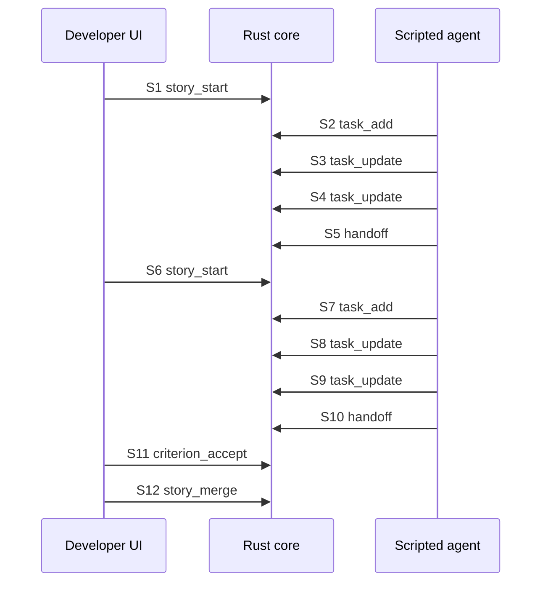

# Merge with a failing Check, and Rebase needed

## Purpose

Merge says no in two cases that the developer can decide. A Check has not passed, and the developer can merge on purpose. A branch conflicts with the base branch, and the developer must ask the agent to rebase. This flow proves both on the review card, with the real core.

## Sequence

The agent is a script (`packages/desktop/e2e/agents/merge-guards-agent.ts`). It serves two Stories, Alpha (FLY-2) and Bravo (FLY-3), and each of its steps runs only for its own Story. The test works in the real UI. The developer starts one Story at a time, so the steps of the two agents do not mix.

1. S1-S5: The developer starts Alpha. The agent writes a Task, commits `notes-alpha.txt` and hands off. The Check of Alpha is `test -f alpha.txt`, and the agent did not write that file, so the Check fails. The hand-off moves the Story to In review. The Story waits in Needs you.
2. S6-S10: The developer starts Bravo. The agent commits `shared.txt` and hands off. The Check of Bravo passes.
3. The test writes a different `shared.txt` on `main` with git, as the developer's own work. This is not a step, because no board command runs. Bravo's branch now conflicts with `main` in that file.
4. S11: The developer opens the review of Alpha. The button is Merge with failing Check, and it is held. The developer accepts the criterion, and the button is ready.
5. S12: The developer selects Merge with failing Check. The confirm names the failing Check. The developer confirms, and the core merges Alpha into `main`. The core records the Check as overridden.
6. The developer opens the review of Bravo. The card has a Rebase needed alert that lists `shared.txt`, and Merge is held. The developer selects Request rebase, and the request for changes starts with a comment that names the base branch and the file. The developer cancels it. This part has no step: the developer sends nothing, and a request for changes is a step of `review-and-merge.md`.

## Entry points

| Step | Path | Symbol |
|---|---|---|
| S1,S6 | `packages/desktop/src-tauri/src/commands/session.rs` | `story_start` |
| S2-S5,S7-S10 | `packages/desktop/src-tauri/src/commands/task.rs` | `handle_inbound_board_tool_request` |
| S11 | `packages/desktop/src-tauri/src/commands/criterion.rs` | `criterion_accept` |
| S12 | `packages/desktop/src/review/ReviewCard.tsx` | `MergeControl` |
| S12 | `packages/desktop/src-tauri/src/commands/review.rs` | `story_merge` |
| none | `packages/desktop/src/review/ReviewCard.tsx` | `RebaseNeeded` |

## Tests

| What it proves | Test path | Covers steps |
|---|---|---|
| A failing Check is merged only through its confirm, and a conflicting branch reads Rebase needed with a request that names the file. The developer works in the real UI, against the real core and sidecar. | `packages/desktop/e2e/flows/merge-guards.spec.ts` | S1-S12 |

## Design

See `ARCHITECTURE.md` section 5 (the IPC seam) and `docs/mvp-spec.md`.

## Last verified

`000f5b540`
