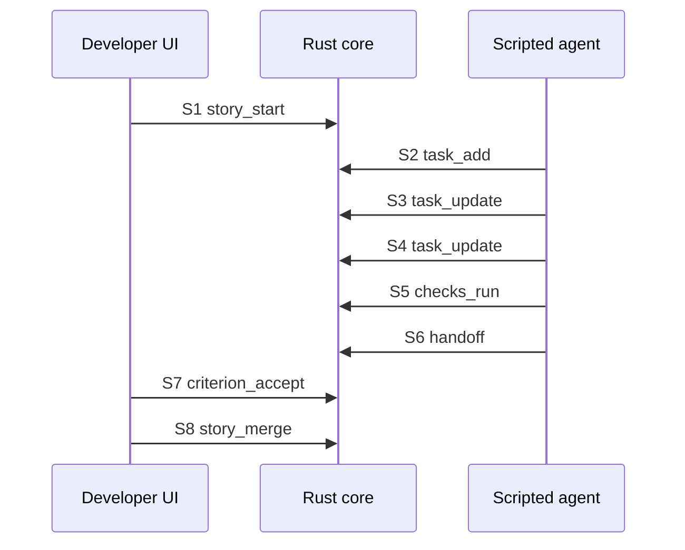

# Merge a Story of a project in a monorepo folder

## Purpose

Flywheel's own project is the `flywheel/` folder of the HighKnow monorepo. The exit test needs a Story to run in a worktree of the whole repository, at that folder, and to merge under it. This flow proves it on a scratch repository with the same shape.

## Sequence

The agent is a script (`packages/desktop/e2e/agents/monorepo-agent.ts`). The project is `<repo>/flywheel`.

1. S1: The developer starts a Ready Story. The core makes a worktree of the whole repository and starts the agent in its `flywheel/` folder.
2. S2-S6: The agent writes a Task, commits `src/parser.rs`, runs the Checks in the project folder and hands off. The commit is at `flywheel/src/parser.rs`.
3. S7: The developer accepts the criterion.
4. S8: The developer merges. `main` gets `flywheel/src/parser.rs`. Nothing lands at the repository root or in `other/`.

## Entry points

| Step | Path | Symbol |
|---|---|---|
| S1 | `packages/desktop/src-tauri/src/commands/session.rs` | `story_start` |
| S2-S6 | `packages/desktop/src-tauri/src/commands/task.rs` | `handle_inbound_board_tool_request` |
| S7 | `packages/desktop/src-tauri/src/commands/criterion.rs` | `criterion_accept` |
| S8 | `packages/desktop/src-tauri/src/commands/review.rs` | `story_merge` |

## Tests

| What it proves | Test path | Covers steps |
|---|---|---|
| A Story of a folder project runs in, checks in and merges under that folder. | `packages/desktop/e2e/flows/monorepo-layout.spec.ts` | S1-S8 |

## Design

See `ARCHITECTURE.md` section 5 and migration 0015 (`worktrees.subdir`).

## Last verified

`105d35c19`
