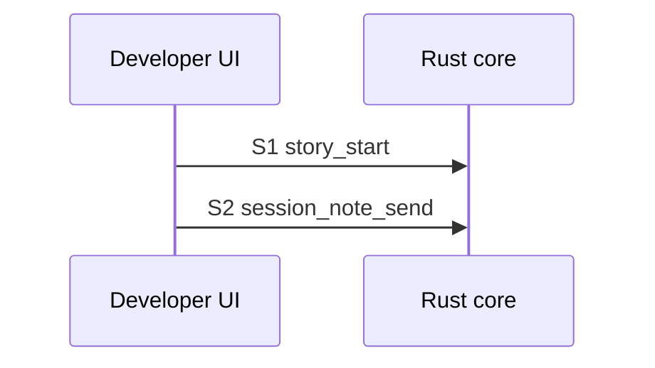

# Send a note to a running agent

## Purpose

The developer sends a note to the agent of a running Story. The agent takes the note after the tool call that it is making, and the board shows the note as delivered.

## Sequence

The agent is a script (`packages/desktop/e2e/agents/note-agent.ts`). It makes short tool calls one after another. After each call, the fake backend runs the `PostToolUse` hooks of the session's own settings file, as the real backend does. The test works in the real UI, and it reads the notes and the agent's log with read-only commands, which are not steps.

1. S1: The developer starts a Story with the Start button, and opens the Story. The Story view has the card "Note to the agent", because the Story has a live session.
2. S2: The developer types a note in the field of the card and selects Send note. The core records the note as sent, and the sidecar queues it. The sidecar does not type into the session.
3. The agent finishes the tool call that it is making. The note hook asks the sidecar for the waiting notes, and adds the note to the agent's context. The sidecar tells the core. The core marks the note delivered, and the card says "Delivered. The agent has it." This step has no command of the developer, so it is not in the diagram.
4. The log of the session holds the note in the text that the hook added. The session is still running, so the note did not interrupt it. The next boundary adds nothing: the agent gets a note once.

## Entry points

| Step | Path | Symbol |
|---|---|---|
| S1 | `packages/desktop/src/board/StoryControls.tsx` | `StartControl` |
| S1 | `packages/desktop/src-tauri/src/commands/session.rs` | `story_start` |
| S2 | `packages/desktop/src/board/NoteToAgent.tsx` | `NoteToAgent` |
| S2 | `packages/desktop/src-tauri/src/commands/steer.rs` | `session_note_send` |
| S2 | `packages/sidecar/src/note-hook.ts` | `hookOutput` |

## Tests

| What it proves | Test path | Covers steps |
|---|---|---|
| A note reaches the agent after its current step and shows as delivered, in the real UI. | `packages/desktop/e2e/flows/note-to-agent.spec.ts` | S1,S2 |
| The sidecar hands a note over at a turn boundary with the fake agent, and never during a tool call. | `packages/sidecar/test/note-delivery.test.mjs` | none |

## Design

See `docs/adr/0044-a-note-to-the-agent-and-a-quick-story.md` and `docs/mvp-spec.md` section 4.7.

## Last verified

Not yet run. The flow was written in a sandbox that cannot run the end-to-end harness.
