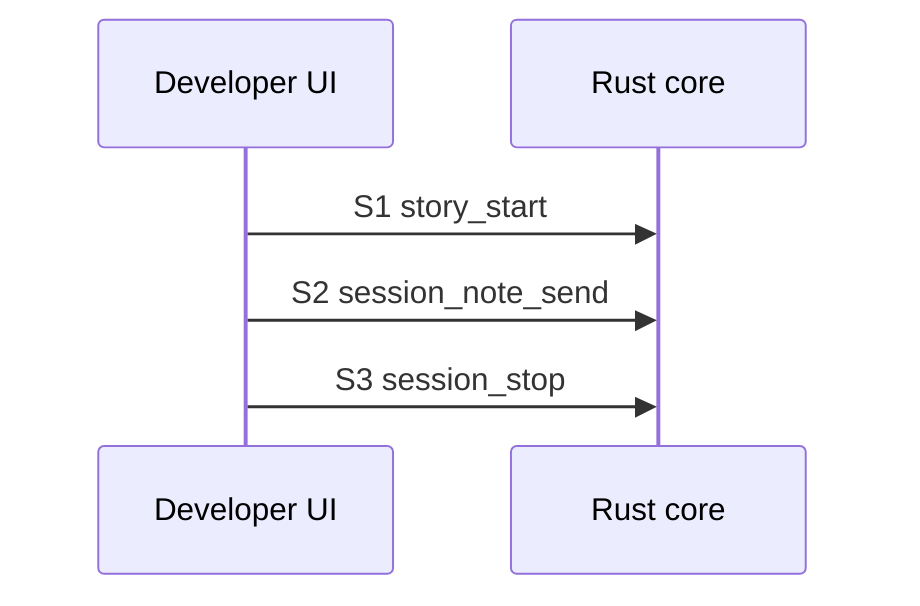

# A note the agent never took

## Purpose

The developer sends a note to an agent that reaches no turn boundary, and then stops the session. The board says in words that the note was not delivered.

## Sequence

The agent is a script (`packages/desktop/e2e/agents/note-agent.ts`). It stays alive and makes no tool call, so no hook runs. The test works in the real UI. Each step below is a control on the screen.

1. S1: The developer starts a Story with the Start button, and opens the Story.
2. S2: The developer sends a note. The card says "Sent. Waits for the agent's next step." It keeps this word, because nothing takes the note.
3. S3: The developer stops the session and confirms. The session ends. The card says "Not delivered. The session ended before the agent took it, and the next session does not receive it." The words of the note stay on the card. The field to write in is gone, because the Story has no live session. The state is derived when the board reads it: no write was needed when the session ended.

The same word covers a hook that dies. The hook takes the note from the sidecar in two phases: it takes the note, then it confirms that it handed the note to the agent. If the hook dies between the two, the sidecar does not report the note as delivered. The note stays pending, and the card keeps "Sent. Waits for the agent's next step." At the next turn boundary, the sidecar gives the note to the next hook run, and the card then says "Delivered. The agent has it." If the session ends first, the card says "Not delivered", as in step 3.

## Entry points

| Step | Path | Symbol |
|---|---|---|
| S1 | `packages/desktop/src/board/StoryControls.tsx` | `StartControl` |
| S1 | `packages/desktop/src-tauri/src/commands/session.rs` | `story_start` |
| S2 | `packages/desktop/src-tauri/src/commands/steer.rs` | `session_note_send` |
| S3 | `packages/desktop/src/board/StoryControls.tsx` | `StopControl` |
| S3 | `packages/desktop/src-tauri/src/commands/session.rs` | `session_stop` |
| S3 | `packages/desktop/src/board/NoteToAgent.tsx` | `NOTE_STATE_WORDS` |
| S3 | `packages/sidecar/src/note-hook.ts` | `hookOutput` |

## Tests

| What it proves | Test path | Covers steps |
|---|---|---|
| A note that no boundary took reads as not delivered after the stop, in the real UI. | `packages/desktop/e2e/flows/note-undelivered.spec.ts` | S1,S2,S3 |
| A hook that dies between the take and the hand-over leaves the note undelivered, and the next turn delivers it. | `packages/sidecar/test/note-delivery.test.mjs` | none |
| The same rule in the core, with a database fixture. | `packages/core/tests/quick_story_and_note.rs` | none |

## Design

See `docs/adr/0044-a-note-to-the-agent-and-a-quick-story.md` and `docs/mvp-spec.md` section 4.7.

## Last verified

Not yet run. The flow was written in a sandbox that cannot run the end-to-end harness.
