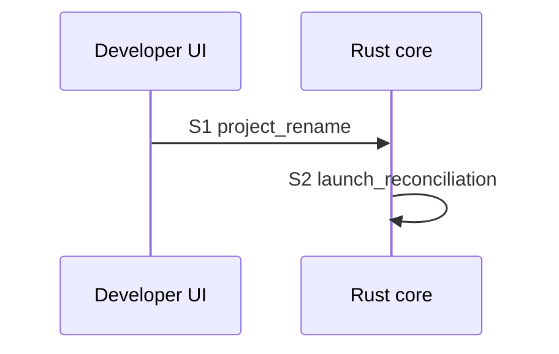

# Rename a project from its menu

## Purpose

A registered project keeps the name it had when it was registered. A developer must be able to change it without a database edit. This flow proves that the new name shows in every place that names the project, that the key prefix and the Story keys do not change, and that the name is still there after the app starts again.

## Sequence

1. S1: The developer opens the project menu in the rail and picks Rename. The developer types a name with spaces around it. The core trims the name, writes it and appends one `project.renamed` event on the project. The core refuses an empty name, a name that is too long and a name that another project has. The key prefix, the key counter and the repository path do not change. The core sends `board:changed`, and the renderer reads the project list again. The new name shows in the rail, in the breadcrumb and in the command palette.
2. The test kills the core with SIGKILL.
3. S2: The test starts a new core on the same data. The project list has the new name.

S2 is not a command. The headless core writes it to the trace when the start path ends.

## Entry points

| Step | Path | Symbol |
|---|---|---|
| S1 | `packages/desktop/src-tauri/src/commands/project.rs` | `project_rename` |
| S2 | `packages/desktop/src-tauri/src/startup.rs` | `boot` |

## Tests

| What it proves | Test path | Covers steps |
|---|---|---|
| A renamed project shows its new name in the rail, the breadcrumb and the palette, keeps its keys, and keeps the name after a restart. | `packages/desktop/e2e/flows/project-rename.spec.ts` | S1-S2 |
| The core trims the name, refuses an empty, a long or a taken name, and keeps the keys. | `packages/core/tests/project_rename.rs` | S1 |
| The menu offers Rename, the dialog keeps the draft when the core refuses, and the command is called once. | `packages/desktop/src/projects/__tests__/project-rail.test.tsx` | S1 |

## Design

See `packages/core/src/domain/project.rs` (`rename_project`) and decision D-10 (Story keys are permanent).

## Last verified

`c6221aa63`
