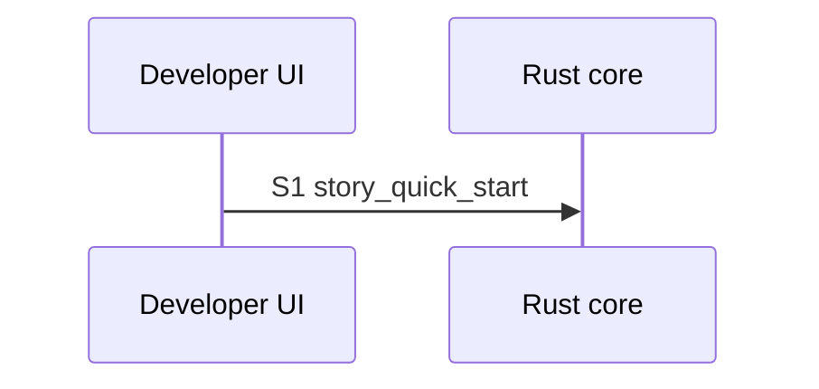

# Write and start a Quick Story

## Purpose

The developer writes one line in one field. Flywheel writes a Story with the default criterion and starts it. The work stays on the board.

## Sequence

The agent does nothing and stays alive (`packages/desktop/e2e/agents/supervised-agent.ts`). The test works in the real UI. It reads the board with read-only commands, which are not steps.

1. S1: The developer selects Quick Story on the board, writes one line, and selects Write and start. The core writes the Story in the Epic "Quick Stories" of the project, makes that Epic on first use, gives the Story one default criterion with no Check, and starts it with the same launch as the Start button. The dialog closes. The Story is Running, has a session, and shows on the board with its key. The first line of the request is the title, and the whole request is the description.

## Entry points

| Step | Path | Symbol |
|---|---|---|
| S1 | `packages/desktop/src/board/QuickStory.tsx` | `QuickStoryDialog` |
| S1 | `packages/desktop/src-tauri/src/commands/steer.rs` | `story_quick_start` |
| S1 | `packages/core/src/domain/quick_story.rs` | `write_quick_story` |

## Tests

| What it proves | Test path | Covers steps |
|---|---|---|
| A Quick Story is written with its criterion and started in one step, in the real UI. | `packages/desktop/e2e/flows/quick-story.spec.ts` | S1 |
| The Story, its criterion and its Epic in the core, with a database fixture. | `packages/core/tests/quick_story_and_note.rs` | none |

## Design

See `docs/adr/0044-a-note-to-the-agent-and-a-quick-story.md` and `docs/mvp-spec.md` section 4.7.

## Last verified

Not yet run. The flow was written in a sandbox that cannot run the end-to-end harness.
