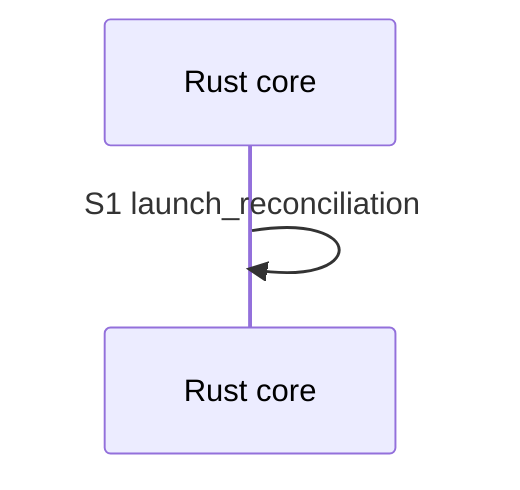

# Quit the app and open it again

## Purpose

A developer quits Flywheel and opens it again. The board must come back as it was left. This flow proves that the Stories, their keys and their states are the same after a quit and a new start, and that the renderer shows them.

## Sequence

1. The test shows the board and reads the Stories of the project.
2. The test quits the core as the app quits: it closes the standard input of the core. The core ends its sessions and the sidecar. No SIGKILL is sent.
3. S1: The test starts a new core on the same data. The core runs the same start path as the app and reconciles projects, worktrees and sessions.
4. The Stories have the same ids, keys, titles and states. The renderer shows the Story key.

S1 is not a command. The headless core writes it to the trace when the start path ends.

## Entry points

| Step | Path | Symbol |
|---|---|---|
| S1 | `packages/desktop/src-tauri/src/startup.rs` | `boot` |

## Tests

| What it proves | Test path | Covers steps |
|---|---|---|
| The Stories of a project are the same after a quit and a new start, and the renderer shows them. | `packages/desktop/e2e/flows/quit-and-reopen.spec.ts` | S1 |

## Design

See `ARCHITECTURE.md`. The store of record is one SQLite database; a quit loses nothing that a commit wrote.

## Last verified

`pending`
