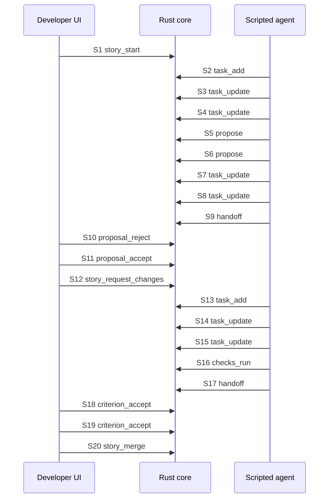

# Review and merge a Story

## Purpose

A developer sends a Ready Story to an agent. The agent works and hands off, the developer decides the agent's Proposals, asks for changes once and merges the Story into the base branch.

## Sequence

The agent is a script (`packages/desktop/e2e/agents/review-agent.ts`). It works in two sessions. The first session ends at S9. The second session runs after S12.

1. S1: The developer starts a Ready Story. The core makes a worktree and starts the agent.
2. S2-S9: The agent writes Tasks, commits a parser and an ADR, files two Proposals and hands off. The Story is In review.
3. S10-S11: The developer rejects one Proposal in the triage drawer and accepts the other in Needs you.
4. S12: The developer asks for changes. A second session starts in the same worktree.
5. S13-S17: The agent adds a Task, commits the fix, re-runs the Checks and hands off again.
6. S18-S19: The developer accepts the two criteria.
7. S20: The developer merges. The ADR stays kept, so it needs no command.

## Entry points

| Step | Path | Symbol |
|---|---|---|
| S1 | `packages/desktop/src-tauri/src/commands/session.rs` | `story_start` |
| S2-S9, S13-S17 | `packages/desktop/src-tauri/src/commands/task.rs` | `handle_inbound_board_tool_request` |
| S10 | `packages/desktop/src-tauri/src/commands/proposal.rs` | `proposal_reject` |
| S11 | `packages/desktop/src-tauri/src/commands/proposal.rs` | `proposal_accept` |
| S12 | `packages/desktop/src-tauri/src/commands/story.rs` | `story_request_changes` |
| S18-S19 | `packages/desktop/src-tauri/src/commands/criterion.rs` | `criterion_accept` |
| S20 | `packages/desktop/src-tauri/src/commands/review.rs` | `story_merge` |

## Tests

| What it proves | Test path | Covers steps |
|---|---|---|
| The real UI takes a Story from Ready to Merged against the real core and sidecar. | `packages/desktop/e2e/flows/review-and-merge.spec.ts` | S1-S20 |
| The same walk through the core and the sidecar, without the UI (UAT 19). | `scripts/uat/uat-19-board-and-review.mjs` | S1-S20 |

## Design

See `ARCHITECTURE.md` section 5 (the IPC seam) and `docs/mvp-spec.md`.

## Last verified

`105d35c19`
