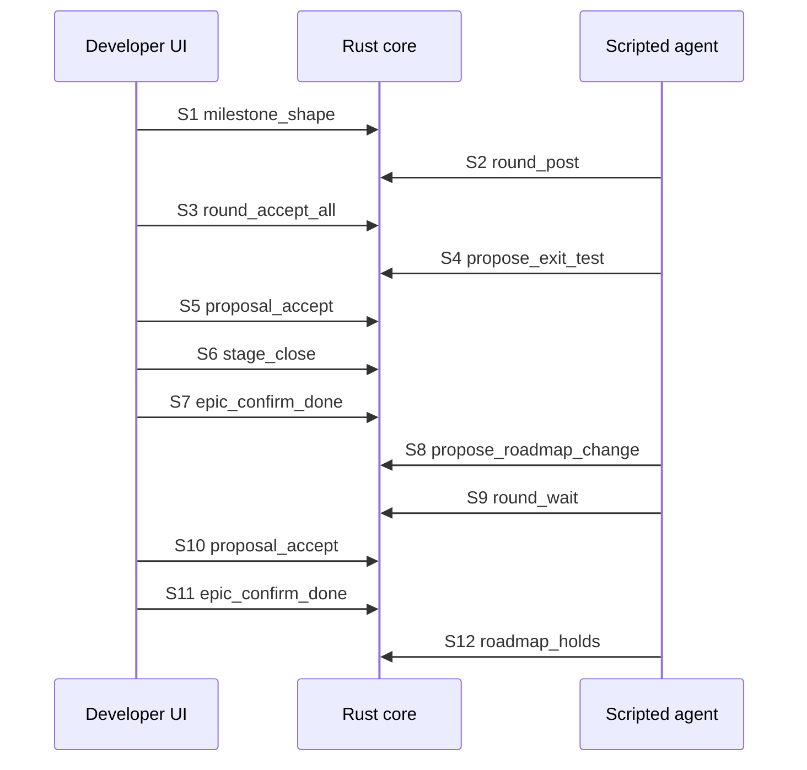

# Shape a Milestone and run roadmap Rounds

## Purpose

A developer shapes the exit test of a Milestone with an agent. Later the developer confirms an Epic Done. Each confirmation runs a roadmap Round. The Round proposes a change, or it says that the Roadmap still holds.

## Sequence

The agent is a script (`packages/desktop/e2e/agents/roadmap-agent.ts`). It reads the packet it starts from and answers that packet.

1. S1-S3: The developer shapes the Milestone. The agent posts one Round. The core holds the call. The developer accepts every recommended answer, and the call ends.
2. S4-S6: The agent proposes a sharper exit test. The developer accepts it and closes the Exit test Stage. The Milestone is Ready with the new exit test.
3. S7-S10: The developer confirms the Epic "Rounds" Done. Roadmap Round 1 opens with a short scope. The agent proposes a New Epic and waits. The developer accepts the Proposal, and this answers the held call. Round 1 closes and the New Epic is on the board in Shaping.
4. S11-S12: The developer confirms the Epic "Roadmap strip" Done. Roadmap Round 2 opens. The agent says that the Roadmap still holds. Round 2 closes with no Proposal.

The core allows one live roadmap session. The test waits for the session of Round 1 to end before S11.

The seed Drops the one Story of each Epic, so each Epic can be confirmed Done. The core accepts a Dropped Story in the same way as a Merged Story. The merge itself is the subject of [review-and-merge.md](review-and-merge.md).

## Entry points

| Step | Path | Symbol |
|---|---|---|
| S1 | `packages/desktop/src-tauri/src/commands/shaping.rs` | `milestone_shape` |
| S2, S4 | `packages/desktop/src-tauri/src/commands/shaping.rs` | `handle_shaping_tool_request` |
| S3 | `packages/desktop/src-tauri/src/commands/shaping.rs` | `round_accept_all` |
| S5, S10 | `packages/desktop/src-tauri/src/commands/proposal.rs` | `proposal_accept` |
| S6 | `packages/desktop/src-tauri/src/commands/shaping.rs` | `stage_close` |
| S7, S11 | `packages/desktop/src-tauri/src/commands/roadmap_round.rs` | `epic_confirm_done` |
| S8-S9, S12 | `packages/desktop/src-tauri/src/commands/shaping.rs` | `handle_shaping_tool_request` |

## Tests

| What it proves | Test path | Covers steps |
|---|---|---|
| A Milestone's exit test is shaped, and two confirmations run two roadmap Rounds, against the real core and sidecar. | `packages/desktop/e2e/flows/roadmap-round.spec.ts` | S1-S12 |
| The same walk through the core and the sidecar with a Node driver (UAT 17). | `scripts/uat/uat-17-roadmap-round.mjs` | S1-S12 |

## Design

See `ARCHITECTURE.md` section 5 (the IPC seam) and `docs/mvp-spec.md`.

## Last verified

`9a31d3e8b`
