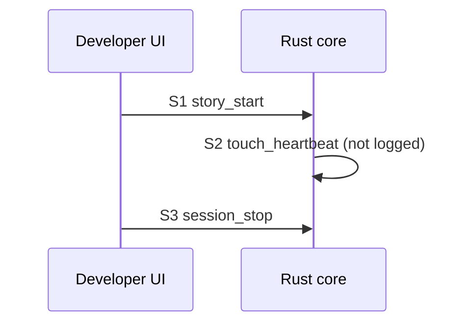

# Keep a session alive past the watchdog window

## Purpose

The sidecar has a watchdog. It kills a session when the heartbeat file is 15 seconds old. The core writes the heartbeat for each session it starts. A session that the core started must live longer than 15 seconds, and it must end clean when the developer stops it.

## Sequence

The agent does nothing and stays alive (`packages/desktop/e2e/agents/supervised-agent.ts`). The test works in the real UI. S1 and S3 are controls on the screen.

1. S1: The developer starts a Story with the Start button on the board, and opens the Story. The run is `running`, and the Story view shows the Stop button.
2. S2: The core touches the heartbeat file on a fixed interval, for as long as it runs. The core does not trace it: it is a thread, not a command.
3. The test waits 20 seconds. This is longer than the 15-second window. The run is still `running`, and the Story view still shows the Stop button, because the core keeps the heartbeat.
4. S3: The developer selects Stop and confirms it. The run ends and is not `failed`. The Story view shows the Resume button. The core log has no `heartbeat-stale` kill.

## Not covered here

The offline UAT `scripts/uat/harness-supervision-gate.mjs` stays. It tests the Node harness that the offline UATs use, not the product. It checks that the harness writes the heartbeat by default, that a session without a heartbeat is killed at the window, and that a wait longer than the window is refused. The core always writes the heartbeat, so the flow cannot run the last two.

## Entry points

| Step | Path | Symbol |
|---|---|---|
| S1 | `packages/desktop/src/board/StoryControls.tsx` | `StartControl` |
| S1 | `packages/desktop/src-tauri/src/commands/session.rs` | `story_start` |
| S2 | `packages/desktop/src-tauri/src/sidecar.rs` | `spawn_sidecar` |
| S3 | `packages/desktop/src/board/StoryControls.tsx` | `StopControl` |
| S3 | `packages/desktop/src-tauri/src/commands/session.rs` | `session_stop` |

## Tests

| What it proves | Test path | Covers steps |
|---|---|---|
| A session that the core started lives past the stale window and ends clean on a stop. The developer starts and stops it in the real UI. | `packages/desktop/e2e/flows/session-supervision.spec.ts` | S1,S3 |
| The three supervision properties of the Node harness (D-105). | `scripts/uat/harness-supervision-gate.mjs` | none |

## Design

See `ARCHITECTURE.md` and `packages/sidecar/src/watchdog.ts`.

## Last verified

`697b72cb2`
