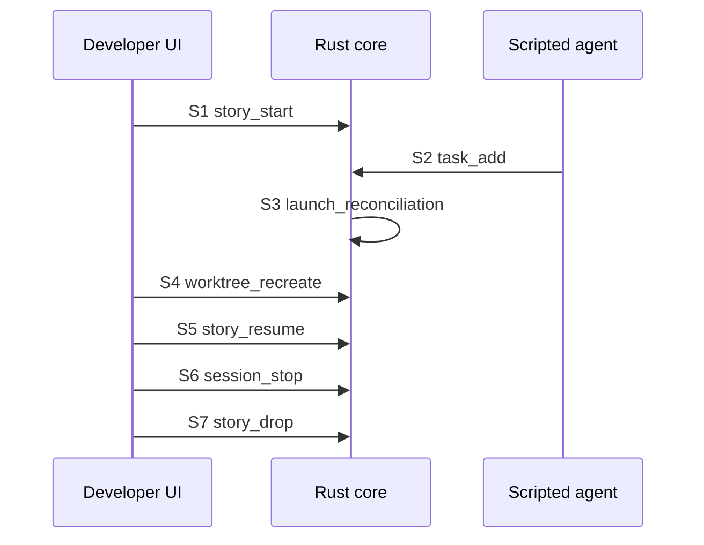

# Recover a Stopped Story

## Purpose

The app can die while an agent session runs, and the Story's worktree folder can be gone when the app starts again. The Story is then Stopped. This flow proves that the developer can recreate the worktree, resume the Story with a note, stop the new session and drop the Story, all in the UI.

## Sequence

The agent is a script (`packages/desktop/e2e/agents/stopped-story-agent.ts`). It stays alive until the developer stops it. Its first session writes one Task. Its second session finds the Resume note in its packet and writes nothing. The test works in the real UI. Each step is a control on the screen, except S2 and S3.

1. S1: The developer selects Start on a Ready Story on the board. The core makes a worktree and a session.
2. S2: The agent writes a Task.
3. The test removes the worktree folder and kills the core with SIGKILL, so no exit step runs. The test kills the agent too.
4. S3: The test starts a new core on the same data. The launch reconciliation writes the session `abandoned` and the worktree `missing`. The Story is Running with no live session, so it is Stopped. Needs you offers Recreate worktree for it, and not Resume.
5. S4: The developer selects Recreate worktree. The core makes the folder again on the same branch, from the same base. The worktree is `active`, and Needs you offers Resume for the Story.
6. S5: The developer selects Resume, types a one-line note and selects Start the new session. The core starts a fresh session in the worktree, and the note is in section 7 of its packet. The Story stays Running. The board does not change its page.
7. S6: The developer opens the Story, selects Stop and confirms it. The session ends, and the Story is Stopped again. The Story view offers Resume.
8. S7: The developer selects Drop on the Story view and confirms it. The Story is Dropped. The core removes its worktree and its branch, and the record stays readable.

S3 is not a command. The headless core writes it to the trace when the start path ends.

## Entry points

| Step | Path | Symbol |
|---|---|---|
| S1 | `packages/desktop/src/board/StoryControls.tsx` | `StartControl` |
| S1 | `packages/desktop/src-tauri/src/commands/session.rs` | `story_start` |
| S2 | `packages/desktop/src-tauri/src/commands/task.rs` | `handle_inbound_board_tool_request` |
| S3 | `packages/desktop/src-tauri/src/startup.rs` | `boot` |
| S4 | `packages/desktop/src/board/NeedsYou.tsx` | `RecreateWorktree` |
| S4 | `packages/desktop/src-tauri/src/commands/session.rs` | `worktree_recreate` |
| S5 | `packages/desktop/src/board/StoryControls.tsx` | `ResumeControl` |
| S5 | `packages/desktop/src-tauri/src/commands/session.rs` | `story_resume` |
| S6 | `packages/desktop/src/board/StoryControls.tsx` | `StopControl` |
| S6 | `packages/desktop/src-tauri/src/commands/session.rs` | `session_stop` |
| S7 | `packages/desktop/src/board/StoryControls.tsx` | `DropControl` |
| S7 | `packages/desktop/src-tauri/src/commands/story.rs` | `story_drop` |

## Tests

| What it proves | Test path | Covers steps |
|---|---|---|
| A Story with a missing worktree is recreated, resumed with a note, stopped and dropped, against the real core and sidecar. The developer works in the real UI. | `packages/desktop/e2e/flows/stopped-story-recovery.spec.ts` | S1-S7 |

## Design

See `ARCHITECTURE.md` section 5 (the IPC seam) and `docs/mvp-spec.md` sections 2 and 4.5.

## Last verified

`000f5b540`
