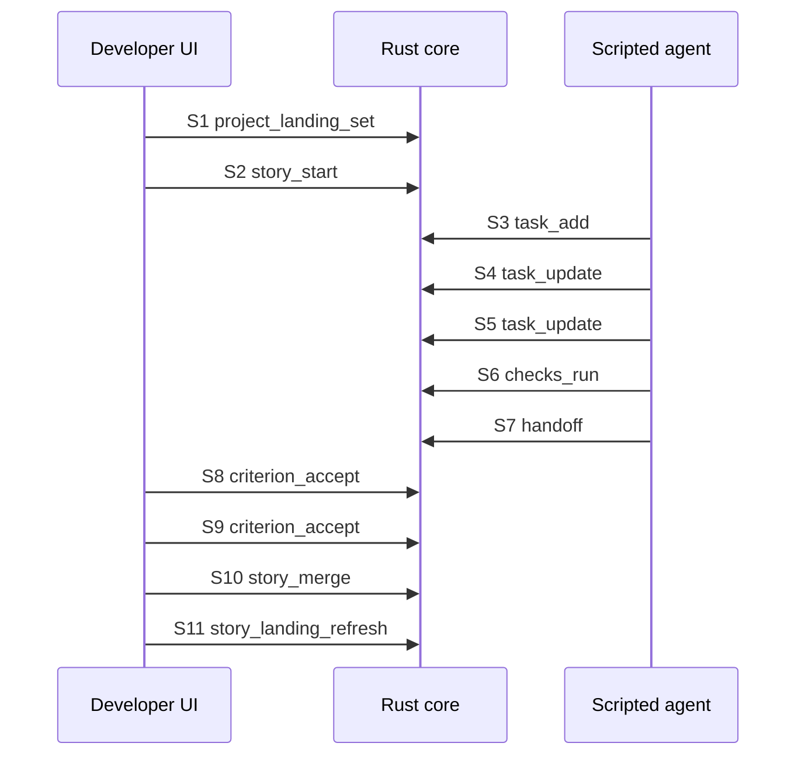

# A Story lands by pull request

## Purpose

A project in a repository that takes changes by pull request only cannot use the local merge: the merge commit would stay on the developer's base branch and no one could push it. Merge opens a pull request instead, and the Story is Landing until the forge merges the request. This flow proves the path with a stub `gh`: the Story is Landing after Merge, and Merged after the forge merges the request.

## Sequence

The agent is a script (`packages/desktop/e2e/agents/monorepo-agent.ts`). The forge CLI is a stub (`packages/desktop/e2e/agents/forge-stub.ts`) that records its calls and answers from files. The remote is the scratch repository's own bare repository.

1. S1: The developer names GitHub as the project's forge in the Landing dialog. The scratch remote's URL is a file path, which no host names.
2. S2-S7: The developer starts the Story. The agent works and hands off. The Story is In review.
3. S8-S9: The developer accepts the two criteria.
4. S10: The developer merges. The core checks that `gh` is installed and signed in, pushes the branch to `origin`, opens a pull request into `main` with auto-merge on, and moves the Story to Landing. The worktree and the local base branch do not change.
5. S11: The stub forge merges the request. The developer chooses "Check now". The core asks the forge, sees the state `MERGED`, removes the worktree and the local branch, and moves the Story to Merged. The local base branch does not change.

The cold tick of the scheduler asks the same question for each Landing Story each minute. This flow uses "Check now" so that the test does not wait for the tick.

## Entry points

| Step | Path | Symbol |
|---|---|---|
| S1 | `packages/desktop/src-tauri/src/commands/landing.rs` | `project_landing_set` |
| S2 | `packages/desktop/src-tauri/src/commands/session.rs` | `story_start` |
| S3-S7 | `packages/desktop/src-tauri/src/commands/task.rs` | `handle_inbound_board_tool_request` |
| S8-S9 | `packages/desktop/src-tauri/src/commands/criterion.rs` | `criterion_accept` |
| S10 | `packages/desktop/src-tauri/src/commands/review.rs` | `story_merge` |
| S11 | `packages/desktop/src-tauri/src/commands/landing.rs` | `story_landing_refresh` |

## Tests

| What it proves | Test path | Covers steps |
|---|---|---|
| The real UI takes a Story to Landing with a pull request, and to Merged when the forge merges it. | `packages/desktop/e2e/flows/story-landing.spec.ts` | S1-S11 |
| Each route, each failure (no CLI, not signed in, push refused, command failed, request closed) and the poll. | `packages/core/tests/story_landing.rs` | S10-S11 |
| The Landing dialog and the Landing panel. | `packages/desktop/src/projects/__tests__/project-rail.test.tsx` | S1 |

## Design

See ADR 0042 (`docs/adr/0042-merge-lands-by-pull-request-by-default-and-keeps-the-local-merge-without-a-forge.md`) and `packages/core/src/domain/landing.rs`.

## Last verified

`not run`
