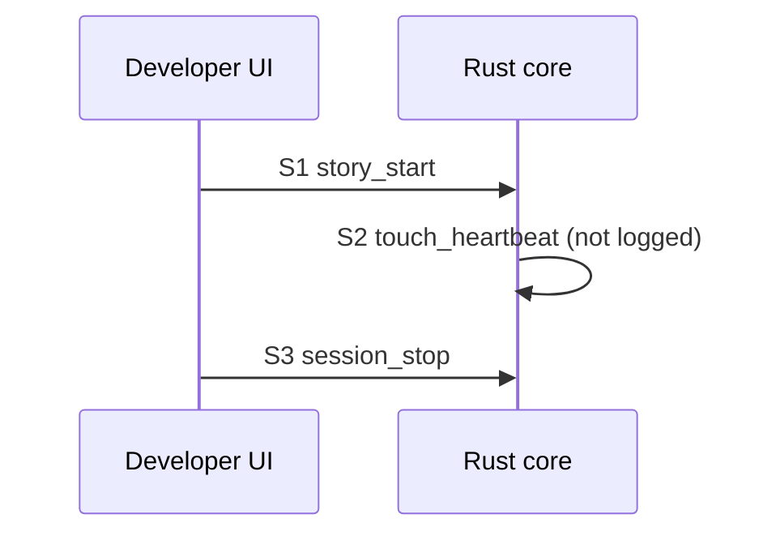

# <flow name>

Copy this file to `docs/flows/<flow-name>.md`. Replace each instruction with the content.
Write in ASD-STE100 Simplified Technical English. Cover one flow. Add the file to the table in
`docs/flows/README.md`. Delete this paragraph.

## Purpose

Write one or two short sentences. State what the flow does and who starts it.

## Sequence

Draw one Mermaid `sequenceDiagram`. A script reads it, so follow the rules in `docs/flows/README.md`.

- Write each message on its own line: `<from>->><to>: S<n> <label>`.
- The label is the name of the command or the board tool that the core traces.
- A step that the code performs but the core does not trace ends with the mark `(not logged)`.
  The test does not compare it. `docs/flows/untraced-steps.json` counts it, and the count can only shrink.
- Do not draw a step that the code does not perform.

## Entry points

Give one row for each step. Use real paths and symbols. A test checks them.

| Step | Path | Symbol |
|---|---|---|
| S1 | `packages/desktop/src-tauri/src/commands/session.rs` | `story_start` |

## Tests

Give one row for the e2e spec that runs the flow. It calls `flow(...)` with `doc: "<flow-name>.md"`.
The row must name every traced step. A test checks that the row exists and that the spec calls the matcher.

| What it proves | Test path | Covers steps |
|---|---|---|
| One short sentence | `packages/desktop/e2e/flows/<flow-name>.spec.ts` | S1,S3 |

## Design

Link to the normative section in `ARCHITECTURE.md`. Do not repeat its content.

## Last verified

Write the commit hash where you last checked the flow against the code.
